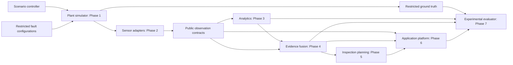

# Architecture

TwinGuard begins as one installable Python modular monolith. Simulation, analytics, evaluation and application platform have independent responsibilities and explicit boundaries. Sharing the public contract package does not grant access to private labels.

Phase 0 supplies the contracts and validation around this information flow. `core.contracts` defines externally persisted public records and scenario configuration; `core.spatial` and `core.time` implement validated numeric/time utilities. `core.serialization.analytics_json` accepts exactly SensorObservation or InspectionCapture and rejects evaluator contracts and subclasses. Pydantic extra-field rejection applies recursively to nested models.

`plant` will implement the physical state and private injections. `sensing` will emit the same observation contract for synthetic, public, hybrid and physical data. `analytics` will consume observations without importing evaluator or scenario control modules. `fusion` will reason over validity and operating conditions. `inspection` will use assessments and coverage. `evaluation` alone compares outputs to truth; its protocol declares an interface without fabricated metric calculations. `api` currently exposes health, versions and capabilities; `cli` manages validation.

The future sensor boundary is an iterable of public observations, the analytics boundary converts those observations into detections/evidence, the evaluator takes output metadata and restricted labels, and the platform stores public contracts and artifact references. See `core/interfaces.py` for protocol definitions. These synchronous protocols permit later process adapters without changing payloads.

Ground truth is stored under datasets/ground_truth, separately from public fixtures. The restricted writer creates directories with mode 0700 and files with mode 0600. This is local filesystem hygiene, not an authentication system: processes sharing the same OS identity can still read these files. Deployment excludes all datasets, so the metadata API cannot serve labels. An eventual evaluator deployment must use separate identities and volume mounts. Scenario files contain private configuration references and are controller inputs; they must never be analytics inputs.

Review decisions before expanding: schema v1 changes require migration review; equipment safe limits require site engineering input; confidence calibration requires measured validation; future access control requires OS/service isolation. No database or message broker is needed in Phase 0.
