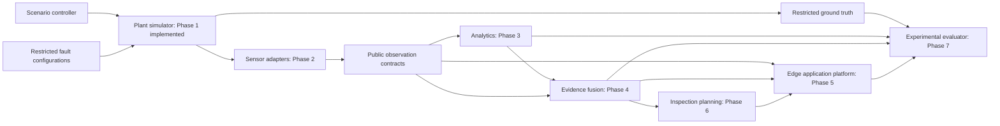

# Architecture

TwinGuard begins as one installable Python modular monolith. Simulation, analytics, evaluation and application platform have independent responsibilities and explicit boundaries. Sharing the public contract package does not grant access to private labels.

Phase 0 supplies the contracts and validation around this information flow. `core.contracts` defines externally persisted public records and scenario configuration; `core.spatial` and `core.time` implement validated numeric/time utilities. `core.serialization.analytics_json` accepts exactly SensorObservation or InspectionCapture and rejects evaluator contracts and subclasses. Pydantic extra-field rejection applies recursively to nested models.

`plant` implements the physical state, versioned meshes, operating dynamics, private injections and replay/export. `sensing/read.py` defines a privileged label-free physical read port for Phase 2; it is not a public observation. `sensing` emits the same observation contract for synthetic, public, hybrid and physical data. `analytics` will consume observations without importing evaluator or scenario control modules. `fusion` will reason over validity and operating conditions. `inspection` will use assessments and coverage. `evaluation` alone compares outputs to truth; its protocol declares an interface without fabricated metric calculations. `api` currently exposes health, versions and capabilities; `cli` manages validation.

The future sensor boundary is an iterable of public observations, the analytics boundary converts those observations into detections/evidence, the evaluator takes output metadata and restricted labels, and the platform stores public contracts and artifact references. See `core/interfaces.py` for protocol definitions. These synchronous protocols permit later process adapters without changing payloads.

Ground truth is stored under datasets/ground_truth, separately from public fixtures. The restricted writer creates directories with mode 0700 and files with mode 0600. This is local filesystem hygiene, not an authentication system: processes sharing the same OS identity can still read these files. Deployment excludes all datasets, so the metadata API cannot serve labels. An eventual evaluator deployment must use separate identities and volume mounts. Scenario files contain private configuration references and are controller inputs; they must never be analytics inputs.

Review decisions before expanding: schema v1 changes require migration review; equipment safe limits require site engineering input; confidence calibration requires measured validation; future access control requires OS/service isolation. No database or message broker is needed in Phase 0.

Phase 1 implementation details are in PLANT_MODEL.md, PHYSICS_MODEL.md and FAULT_INJECTION.md. Canonical roadmap: edge platform is Phase 5; risk-adaptive inspection is Phase 6. Phase 2 sensing is implemented; analytics algorithms remain pending. Run manifests, physical state and geometry are simulator-management artifacts and must not be passed to analytics.

Phase 2 layers: the acquisition controller alone receives the label-free physical read port; imaging sensors raycast first visible triangles and IoT models sample actual process/spatial fields. Capture envelopes separate public records/allowlisted arrays from private references. Public ingestion lives in core.observations and imports neither plant nor evaluator modules. Privileged evaluation/sensing.py computes measurement-model errors and attaches exact plant truth separately. Analytics consumers cannot import the sensing implementation or physical read port. The metadata API advertises implemented capabilities but exposes no sensing, analysis, private-data or fusion endpoints. Optional Open3D dependencies are isolated from the minimal API container.

## Phase 3 update

Phase 3 implementation update: analytics consumes only core public records/artifacts plus explicit accepted-reference/calibration data. core.boundaries rejects imports of plant, sensing implementations, evaluation or private scenario controls from consumers. evaluation/experiments orchestrates privileged generation and subsequent truth-free inference; evaluation/analytics verifies persisted prediction seals before reading labels. Analytics, experiment and reporting CLI commands are implemented. API remains metadata-only and optional Open3D/SciPy do not enter its minimal image. Historical pending-analytics statements above describe the Phase 2 handoff.

## Phase 4 update

Phase 4 now implements public-output evidence adaptation, strict temporal/spatial/dependence qualification, hazard policies, advisory lifecycle and deterministic checkpoint replay within the modular monolith. Core fusion imports neither physical simulation nor restricted evaluation. Metadata API/CLI advertise the implemented advisory capability. No broker, service transport, dashboard or plant control is implemented. See FUSION_ARCHITECTURE.md.
