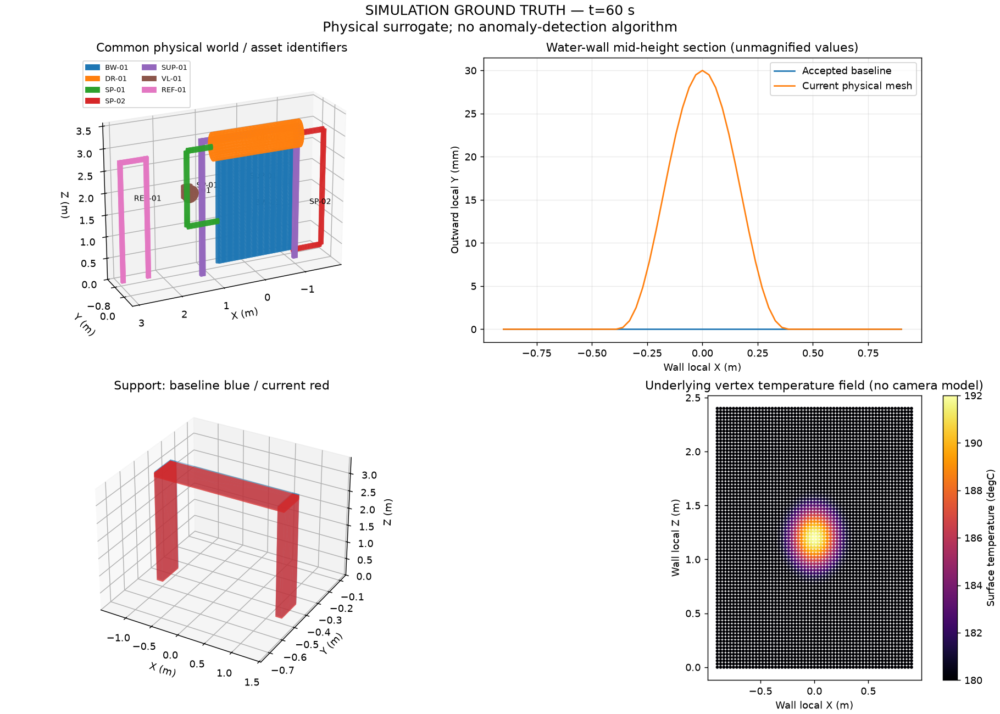
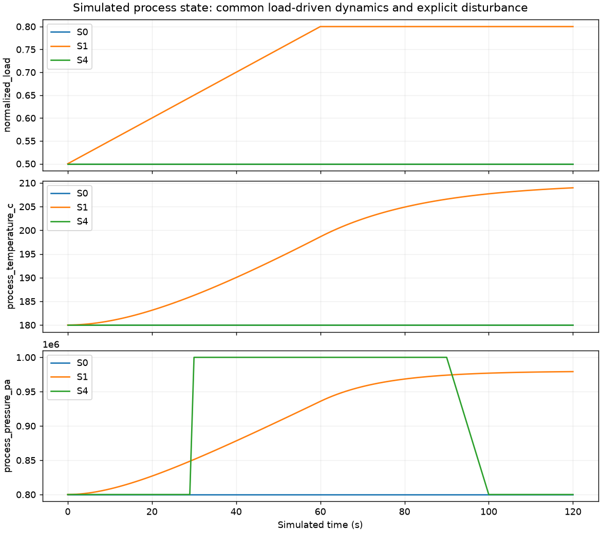

# Phase 1 validation and completion report

Executed 27 October 2026, Python 3.12.3/Linux, TwinGuard 0.2.0, schema 1.0.0. Phase 0 baseline before edits: **54 passed, 1 upstream warning**. Final integrated suite: **102 passed, 0 failed, 1 upstream warning** in 8.95 s. Ruff lint/format, Mypy (33 source files), package installation, pip check, schema export and the complete scripts/validate.sh passed. No tests were skipped. The warning is the existing FastAPI/Starlette HTTPX deprecation; no functionality failed.

## Measured physical/numerical results

The complete machine-readable measurement is [phase1_validation.json](phase1_validation.json). These are simulation-ground-truth checks, not industrial accuracy measurements.

The default plant has **7 physical assets, 27,184 vertices and 54,244 triangles**. Every component mesh was finite, index-valid, free of zero-area triangles and watertight as a concatenation of closed primitives. Overlapping joints are not Boolean-unioned CAD solids. World bounds and per-asset mesh sizes are in the JSON.

| Injected deformation | Actual mesh peak | Absolute error | Result |
|---|---|---|---|
| 10 mm | 10 mm | 1.73e-18 m | PASS (1e-10 m tolerance) |
| 20 mm | 20 mm | 3.47e-18 m | PASS (1e-10 m tolerance) |
| 30 mm | 30 mm | 0 m | PASS (1e-10 m tolerance) |
| 50 mm | 50 mm | 0 m | PASS (1e-10 m tolerance) |

S1 at 60 s: temperature rise 18.633974416 degC; analytical expansion **0.536658463 mm**, measured mesh extent change **0.536658463 mm**, absolute error 1.03e-16 m (tolerance 1e-12 m). Support translation configured [20, -10, 5] mm; maximum vertex translation error 1.07e-16 m (tolerance 1e-12 m). Rebuilt replay geometry was bitwise equal; operating-state records matched, including after reordered time queries.

| Scenario | Generation including baseline and selected exports | Process samples | Snapshot times (s) |
|---|---|---|---|
| S0 | 0.230946 s | 121 | [0, 60, 120.0] |
| S1 | 0.229467 s | 121 | [0, 60, 120.0] |
| S2 | 0.247605 s | 121 | [0, 60, 120.0] |
| S3 | 0.247414 s | 121 | [0, 60, 120.0] |
| S4 | 0.238953 s | 121 | [0, 60, 120.0] |
| S5 | 0.271142 s | 121 | [-3600.0, 0, 60, 120.0] |

Entire numerical/geometry report, seven runs and scientific rendering: **5.633084 s**. Linux process peak RSS: **250.996 MiB**, including Matplotlib/rendering and export. These are one measured local run, not guaranteed performance or isolated simulator benchmarks.

## Artifacts and visual inspection

All figures use the actual mesh/state arrays. The composite displays the common plant, an unmagnified-value 30 mm bulge section, support overlay and a +12 degC underlying field. It is explicitly simulation ground truth. The field plot is not a thermal-camera image. The rendered output was opened and visually inspected.





Small figures and the measurement JSON are intentional review artifacts under docs/. Full generated meshes, fields, time series, private labels and run manifests remain Git-ignored at datasets/synthetic/generated/phase1-release/. Key paths relative to that directory:

- S0/baseline/plant.glb: accepted baseline; per-asset PLY and assets.json beside it.
- S2/snapshots/t_60/plant.glb: faulty current world; PLY, field NPZ and metadata beside it.
- S0–S5/operating_states.json: timestamped process traces.
- S0–S5/restricted/ground_truth.json: typed exact fault state; scenario/fault copies and event timeline are alongside it.
- S0/S2/S3/SUPPORT/visualization/t_60.png: individual healthy/deformation/thermal/support views.
- validation.json, combined_ground_truth.png and operating_traces.png: quantitative report and combined visuals.

CLI commands were also executed against output/phase1-plant, output/phase1-S0 and output/phase1-S2. Baseline build, S0/S2 simulation, GLB snapshot, visualization and inspect all succeeded. Invalid inputs return nonzero codes; nonempty run directories are not overwritten. load_run validates SHA256 artifacts before rebuilding the plant from saved private configuration.

## Reproduce

```bash
source .venv/bin/activate
pip install -r requirements-dev.lock
pip install -e '.[dev,viz]' --no-deps
bash scripts/validate.sh
ruff check src tests scripts
ruff format --check src tests scripts
mypy src
pip check
python scripts/validate_phase1.py --output-dir datasets/synthetic/generated/new-validation
twinguard plant build --config configs/plant.yaml --output-dir output/new-plant
twinguard plant simulate --scenario scenarios/S0.yaml --output-dir output/new-S0
twinguard plant simulate --scenario scenarios/S2.yaml --output-dir output/new-S2
twinguard plant snapshot --run-dir output/new-S2 --time 60 --format glb
twinguard plant visualize --run-dir output/new-S2 --time 60
twinguard plant inspect --run-dir output/new-S2
```

The pinned environment is Python 3.12 Linux; Python 3.11 was not independently tested. The shell sandbox lacked bubblewrap, so approved shell execution was used. Dependency downloads were slow; Docker build validation used its existing optional loopback wheel-mirror build arguments and then the unchanged Compose runtime configuration. The Docker image built successfully; Compose reported the API healthy, and /health, /version (0.2.0 / schema 1.0.0), and /capabilities all returned HTTP 200. No GPU, desktop or network is needed for installed simulation runs.

## Acceptance criteria

| # | Criterion | Status and executed evidence |
|---|---|---|
| 1 | Existing Phase 0 tests | PASS: all 54 retained checks pass within the 102-test suite |
| 2 | Phase 0 corrections | PASS: S2 inspections/persistence, optional sensor fields, maturity/run status separation, recursive boundary tests and canonical roadmap |
| 3 | Seven identifiable assets | PASS: exact ID registry and node export tests |
| 4 | Reproducible baseline | PASS: defensive-copy and independent numerical replay tests |
| 5 | Time-dependent operating conditions | PASS: steady/ramp/startup/decrease/process tests and actual traces |
| 6 | Normal thermal expansion | PASS: measured versus analytical extent change above |
| 7 | Actual wall deformation | PASS: 10/20/30/50 mm, zero out-of-region displacement and valid deformed triangles |
| 8 | Support geometry movement | PASS: actual world vertices and pose match configured translation |
| 9 | Spatial thermal hotspot | PASS: actual vertex field +12 degC and timed recovery |
| 10 | Process disturbance | PASS: intended variable changes without invented geometry/thermal response |
| 11 | S0–S5 execution | PASS: exported all six runs and validated samples |
| 12 | Arbitrary valid snapshots | PASS: random-access calls and CLI 12.5 s export; invalid time tests |
| 13 | Isolated truth | PASS: restricted typed records, separate permissioned paths, allowlist rejection and recursive import audit |
| 14 | Mesh/numerical export | PASS: GLB/PLY round trips, node IDs/bounds, JSON/NPZ and checksums |
| 15 | Healthy/faulty visual outputs | PASS: actual headless PNGs, GLB scenes and visual inspection |
| 16 | Reproducibility tests | PASS: deterministic seeds, controlled stochastic variation, query order and persisted reload |
| 17 | Numerical/geometry report | PASS: computed JSON/tables/traces/resource measurements |
| 18 | CLI commands | PASS: build/simulate/snapshot/visualize/inspect and invalid-input checks |
| 19 | Documentation | PASS: architecture/contracts/physics/faults/scenarios/roadmap/evidence updated; original required documents remain Git tracked |
| 20 | Lint/type/test checks | PASS: Ruff, formatting, Mypy and 102 tests |

## Limits and Phase 2 handoff

This is an affine-load, first-order surrogate with axial unconstrained expansion and superposed compact faults. It lacks thermodynamics, structural stresses, flow, material aging, validated sensor physics, industrial thresholds and mechanical coupling. Mesh joints overlap; spatial thermal fields are vertex sampled and extruded through wall thickness. Off-grid fault peaks can be undersampled. Numerical agreement with the implemented formula does not establish agreement with a real boiler. E1–E4 remain not_implemented; no accuracy or TRL rating is claimed.

PhysicalStateReader exposes a single timestamped common world: frame/model/configuration references, world triangles, per-vertex temperatures, pressure, process temperature, ambient temperature and load. Phase 2 must supply raycasting, projection/interpolation, calibration, sampling schedules, uncertainty/noise and physical sensor adapters, then emit only public SensorObservation/InspectionCapture records to analytics. Restricted evaluator access remains separate. No additional physical-state interface is required to start those models; detailed acquisition and sensor-calibration semantics still need engineering work. No Phase 2 code was implemented.

Artifact IDs are hashes of relative paths, so adding snapshots preserves prior identifiers. Full-precision decimal time tokens avoid collisions between nearby arbitrary timestamps. Snapshot exports also append their exact evaluation-time truth under restricted/. Both behaviors were checked, with stable-ID and distinct-time automated tests.
