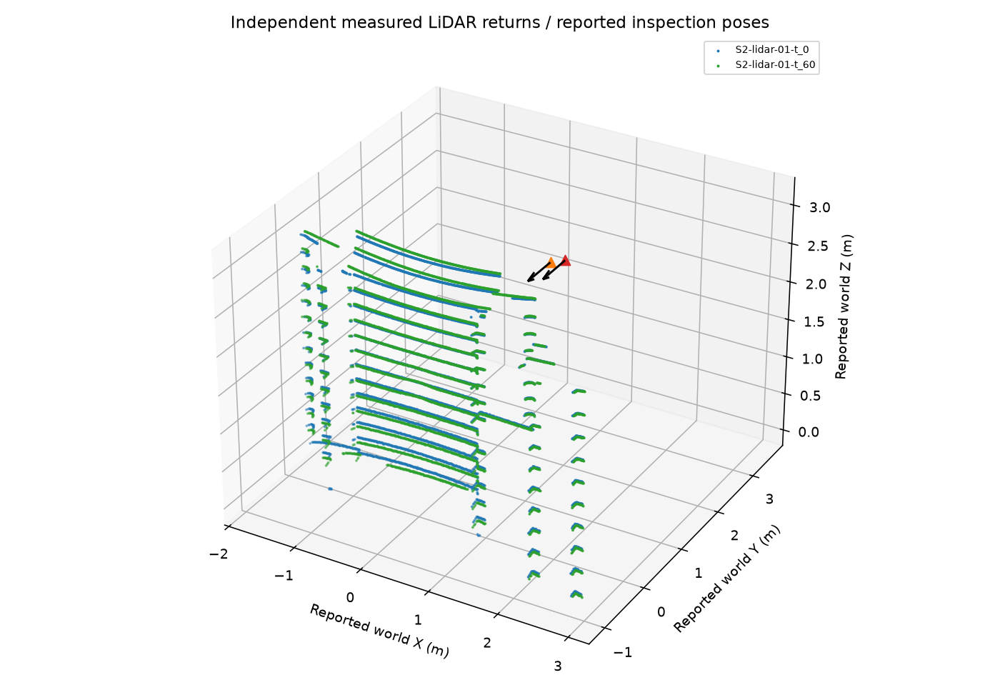
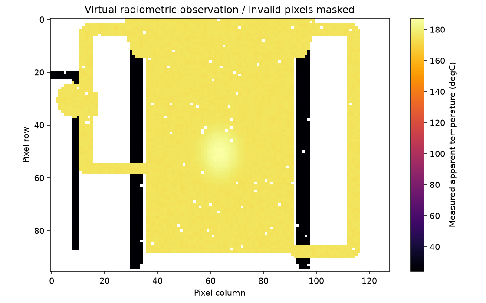
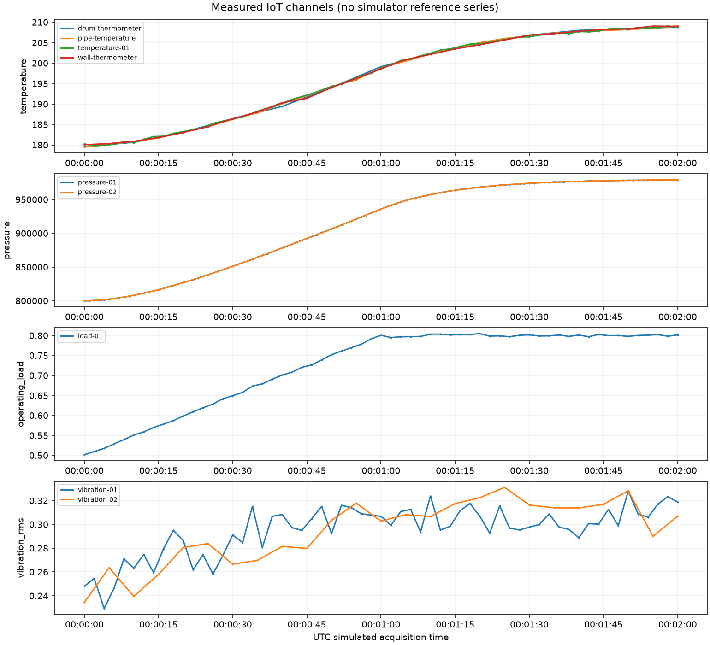

# Phase 2 validation and implementation report

Implementation branch: phase-2-virtual-sensing, created from phase-1-plant-simulator (105bc0e). The starting tree was clean. Executed 27 October 2026 on Linux/Python 3.12.3, package 0.3.0, schema 1.0.0, Open3D 0.19.0 CPU.

Baseline: **102 passed**, one upstream HTTPX warning. Integrated checks: **148 passed, 0 failed, no skips**, one unchanged warning, in 18.92 s. Ruff lint and format passed (54 Python files formatted); Mypy passed for 46 source files; package installation and pip check passed; all scenario/schema/CLI checks in scripts/validate.sh passed. Display-free sensor tests were also executed with DISPLAY and WAYLAND_DISPLAY unset. The warning comes from FastAPI/Starlette deprecating its HTTPX test-client integration; migration is dependency maintenance, not a test failure.

Open3D installed successfully despite an attempted interruption of its large download. CPU runtime import and numerical tests passed. The default uses Open3D RaycastingScene, not vertex sampling. The explicit NumPy BVH alternative was checked independently against first-hit geometry. Open3D uses float32 intersections; analytical-plane and transformed-point checks use 2e-5 m tolerance, with separate noiseless diagnostic references. No GPU or display is used.

## Actual quantitative results

[phase2_sensing_validation.json](phase2_sensing_validation.json) contains all six scenarios and S2 fidelity variants, per-event/per-channel statistics, measured runtime and resource information. Full artifacts are Git-ignored under datasets/synthetic/generated/phase2-final/. These comparisons are restricted virtual-sensor verification, not physical accuracy or anomaly detection.

| S2 setting/event | Rays | Returns | Return fraction | Range RMSE | Pose translation error | Pose rotation error |
|---|---|---|---|---|---|---|
| S2-L0 / 0 s | 11520 | 5617 | 48.7587% | 0.0000 mm | 0.0000 mm | 0.000000 rad |
| S2-L0 / 60 s | 11520 | 5295 | 45.9635% | 0.0000 mm | 0.0000 mm | 0.000000 rad |
| S2-L1 / 0 s | 11520 | 5511 | 47.8385% | 4.1327 mm | 19.5559 mm | 0.003444 rad |
| S2-L1 / 60 s | 11520 | 5214 | 45.2604% | 4.1062 mm | 24.4545 mm | 0.003265 rad |
| S2-moderate / 0 s | 11520 | 5247 | 45.5469% | 11.9002 mm | 78.2236 mm | 0.017218 rad |
| S2-moderate / 60 s | 11520 | 4990 | 43.3160% | 11.7659 mm | 97.8180 mm | 0.016325 rad |
| S2-L2 / 0 s | 11520 | 6012 | 52.1875% | 29.0977 mm | 78.2236 mm | 0.017218 rad |
| S2-L2 / 60 s | 11520 | 5674 | 49.2535% | 28.4893 mm | 97.8180 mm | 0.016325 rad |

Range RMSE compares retained measured ranges to separately stored noiseless first-hit references, not to an assumed sigma. L0's zero stochastic range error is expected by definition; independent known-geometry tests establish numerical correctness separately. Pose errors are actual matrix differences and remain outside public observations. Different S2 views are raycast independently at 0/60 s. No direct point correspondences are supplied. The degraded FoV is narrower and concentrates rays on the plant, so its return count can increase despite reduced angular coverage and increased noise/dropout. Return fraction is not surface-area completeness.

| Thermal event | Valid / pixels | Valid fraction | Apparent-model RMSE | Difference from physical surface RMSE |
|---|---|---|---|---|
| S0-thermal-01-t_60 | 7213 / 12288 | 58.6995% | 0.300781 degC | 4.371211 degC |
| S1-thermal-01-t_60 | 7185 / 12288 | 58.4717% | 0.302856 degC | 4.707706 degC |
| S2-thermal-01-t_60 | 7191 / 12288 | 58.5205% | 0.299286 degC | 4.366854 degC |
| S3-thermal-01-t_60 | 7195 / 12288 | 58.5531% | 0.301822 degC | 4.373959 degC |
| S4-thermal-01-t_60 | 7201 / 12288 | 58.6019% | 0.301991 degC | 4.371507 degC |
| S5-thermal-01-t_60 | 7203 / 12288 | 58.6182% | 0.296538 degC | 4.366027 degC |

The two thermal columns are deliberately different. Apparent-model error measures simulated instrument noise around the assumed grey-body equation. Surface-temperature difference also includes emissivity/reflection and is several degrees here; the smaller number is not a commercial or physical-camera accuracy claim. Occlusion tests ensure hidden hot surfaces cannot shine through opaque foreground triangles.

| S1 nominal channel | Unique received / expected | Completeness | Measured RMSE (channel SI/Celsius unit) |
|---|---|---|---|
| drum-thermometer | 13 / 13 | 100.0000% | 0.29480415 |
| load-01 | 61 / 61 | 100.0000% | 0.0020458077 |
| pipe-temperature | 24 / 25 | 96.0000% | 0.19069756 |
| pressure-01 | 121 / 121 | 100.0000% | 140.07661 |
| pressure-02 | 40 / 41 | 97.5610% | 156.65353 |
| temperature-01 | 59 / 61 | 96.7213% | 0.1821909 |
| vibration-01 | 61 / 61 | 100.0000% | 0.0048235522 |
| vibration-02 | 25 / 25 | 100.0000% | 0.0039246775 |
| wall-thermometer | 25 / 25 | 100.0000% | 0.21846278 |

Temperature errors use degC, pressure Pa, load normalized fraction, vibration RMS m/s2. Completeness counts unique delivered IDs and excludes duplicates from the numerator. Full per-channel mean/std/MAE, transport counts and expected attempts are in the JSON. The vibration reference is an explicitly assumed load-only feature model, with no automatic geometric-fault correlation.

The ten complete acquisitions (six nominal scenarios, three S2 variants and an independent reverse-order repeat) plus plots took **19.680314 s**. Linux process peak RSS was **783.777 MiB**, including interpreter, Open3D, plant data, acquisition and rendering. These are measured local values, not guaranteed throughput or isolated modality memory budgets. Per-event acquisition times and per-run process peaks are retained in the JSON.

Reproducibility: metadata equality and numeric-array equality were both **true** for an independent same-seed S2 repeat with thermal-before-LiDAR execution. Unit tests also reverse IoT sensor order. Stochastic effects change with seed; deterministic geometry and default operating dynamics do not. This is frozen-environment repeatability, not a cross-platform bit-identical guarantee.

## Actual observation figures

The following files were generated from the measured arrays and opened for visual review. No fault-classification overlay or true correspondence is drawn.







[Single LiDAR view](figures/phase2_lidar.png) and [sensor coverage](figures/phase2_coverage.png) are also retained. Coverage explicitly labels its private geometry backdrop as simulation context; it must not be interpreted as measured points. Temperature images show apparent radiometric temperature and a color scale; invalid pixels remain masked.

## Exact artifact paths

Relative to datasets/synthetic/generated/phase2-final/:

- S2/observations/lidar/S2-lidar-01-t_0.npz and .ply: baseline measured scan; matching .json is InspectionCapture metadata.
- S2/observations/lidar/S2-lidar-01-t_60.npz and .ply: independently acquired current scan and reported pose.
- S3/observations/thermal/S3-thermal-01-t_60.npz, .npy, .png, .json: numeric frame/mask, presentation and calibration metadata.
- S1/observations/iot/observations.jsonl and observations.csv: nine-channel records in delivery order.
- Each run's observations/sensor_installation.json: known fixed-channel metadata; manifest.json: public provenance and checksums.
- Each run's evaluation_private/: true poses/hits/references, sensor_truth.json, controller installation/scenario and plant_truth.json evaluator context. These are not normal analytics inputs.
- Each run's reports/sensing_validation.json and .md: restricted-reference diagnostic summaries.
- S2/visualizations/, S3/visualizations/, S1/visualizations/: measured scan, frame and time-series plots.
- sensing_validation.json: aggregate measured report, also copied to docs/phase2_sensing_validation.json.

All sensing CLI operations were executed: LiDAR in output/phase2-first-lidar, thermal in output/phase2-cli-thermal, IoT in output/phase2-cli-iot, scheduled S2 in output/phase2-cli-S2, then validate and visualize. Output paths are new/empty; failures return nonzero. Public manifests/records/arrays and SHA256 references were validated. Full data are ignored by Git; the small plots and report JSON under docs/ are intentional review artifacts.

## Reproduce and build

```bash
python3 -m venv .venv
source .venv/bin/activate
pip install -r requirements-dev.lock
pip install -e '.[dev,viz,sensing]' --no-deps
bash scripts/validate.sh
ruff check src tests scripts
ruff format --check src tests scripts
mypy src
pip check
env -u DISPLAY -u WAYLAND_DISPLAY python -m pytest -q tests/test_phase2_geometry.py
python scripts/validate_phase2.py --output-dir datasets/synthetic/generated/new-phase2-validation
twinguard sensing lidar --scenario scenarios/S2.yaml --time 60 --output-dir output/new-lidar
twinguard sensing thermal --scenario scenarios/S3.yaml --time 60 --output-dir output/new-thermal
twinguard sensing iot --scenario scenarios/S1.yaml --output-dir output/new-iot
twinguard sensing simulate --scenario scenarios/S2.yaml --output-dir output/new-S2-sensing
twinguard sensing validate --run-dir output/new-S2-sensing
twinguard sensing visualize --run-dir output/new-S2-sensing
```

The minimum API runtime lock excludes optional Open3D; requirements-sensing.lock pins the API plus sensing runtime and requirements-dev.lock the full validated environment. Existing Docker/Compose configuration validated and the updated CPU-only API image built successfully. Build-time dependencies were served from a temporary loopback mirror using the Dockerfile's existing PIP_FIND_LINKS/PIP_NO_INDEX arguments; normal online builds use PyPI. The API container exposes only metadata, not sensing or private artifacts. A sensing job must install the sensing extra or explicitly select the tested NumPy backend; the minimal API image is not falsely presented as the full Open3D environment. Python 3.11 was not tested. Standard shell sandboxing lacked bubblewrap; approved shell execution was used.

## Completion matrix

| # | Acceptance criterion | Decision and executed evidence |
|---|---|---|
| 1 | Phase 0/1 regression | PASS: all original 102 tests retained and passing |
| 2 | Phase 1 improvements | PASS: actual visibility, independent scans, strict reference isolation and parent-pose resolution |
| 3 | First-visible LiDAR raycasting | PASS: Open3D CPU triangle intersections and analytical tests |
| 4 | Occluded/hidden geometry excluded | PASS: foreground occlusion, misses and too-near occluder tests |
| 5 | Configurable LiDAR range/pattern/noise | PASS: typed numeric presets, bounds, noise/statistical tests |
| 6 | True/reported poses separated | PASS: private true matrices; only reported pose/estimated uncertainty exported |
| 7 | Independent baseline/current scans | PASS: separate current world/pose/raycast/noise per event |
| 8 | S2 scans at 0/60 s | PASS: full-resolution measured returns and actual 30 mm mesh effect verification |
| 9 | Point-cloud round trip | PASS: public NPZ/PLY reload with stated numerical tolerance |
| 10 | Visible plant temperatures projected | PASS: per-triangle barycentric field samples |
| 11 | Documented radiometric approximation | PASS: Kelvin emissivity/reflection equation tests |
| 12 | Hidden hotspot occlusion | PASS: opaque foreground thermal test and actual S3 projection |
| 13 | Coherent IoT sources | PASS: actual process/asset field reads; documented vibration surrogate |
| 14 | Temperature/pressure/load/vibration | PASS: nine configured channels, units and source tests |
| 15 | Noise/quality configuration | PASS: assumed measurement/pose/delivery parameters and saturation flags |
| 16 | Different sampling rates/timestamps | PASS: per-channel intervals, UTC, jitter and sequence tests |
| 17 | Delay/missing/out-of-order | PASS: transport simulation, duplicates and interruption-window tests |
| 18 | Same-seed repeatability | PASS: independent metadata/array equality and statistical tests |
| 19 | Execution-order independence | PASS: reversed imaging and IoT order comparisons |
| 20 | Private truth isolation | PASS: exact-type serialization, closed arrays, reserved keys and safe manifest-only loaders |
| 21 | Six scenarios execute | PASS: S0–S5 full-resolution runs plus reduced integration tests |
| 22 | Valid manifests/provenance | PASS: existing public contracts, source/license checks and checksums |
| 23 | Actual measured visualizations | PASS: point clouds, independent scan comparison, radiometric arrays, IoT and labeled coverage context |
| 24 | Quantitative model reports | PASS: computed per-scenario/configuration metrics above and in JSON |
| 25 | Lint/type/tests | PASS: Ruff, format, Mypy and 148 tests |
| 26 | Phase 3 interfaces | PASS: public observation/array loaders, reported poses/uncertainty, camera calibration and UTC streams; evaluator truth is separate |

## Limits and Phase 3 handoff

Known-plane tests establish numerical behavior; distribution checks establish consistency with assumed statistical models; neither establishes calibrated physical realism. Scans are instantaneous and lack intensity/material response, multipath and motion distortion. Thermal assumes global grey-body emissivity/reflection without atmospheric/spectral calibration. Surface fields and closest-surface thermometers inherit Phase 1 geometric/physical simplifications. Vibration is phenomenological; process channels do not solve spatial flow/pressure networks. Coverage is incomplete. The one upstream test-client deprecation remains.

Phase 3 should load InspectionCapture/SensorObservation records with core.observations.load_public_observations, load measured arrays using load_capture_arrays, and use sensor_pose plus reported standard deviations and acquisition parameters. Baseline/current point counts and views differ; registration must solve its own correspondences. Thermal input is numeric temperature_c with valid_mask and camera metadata; IoT input is normalized-unit public JSONL with separate acquisition/receipt times and known installation source/location metadata. Only the independent evaluator may access evaluation_private for actual poses, noiseless sensor references and exact plant faults. No registration, change detection, anomaly classification, evidence fusion or other Phase 3 feature was implemented. E1–E4 remain not_implemented. No physical accuracy or TRL rating is claimed.

Final artifact audit: all ten runs passed manifest/file checksums, public array validation, record-to-dataset provenance consistency, and presence of the separate exact plant evaluator context. The repeat-run context was added during this audit; the generator now writes it automatically. Configuration fingerprints are canonicalized so default-field serialization cannot change dataset identity.

Final Docker smoke: the delivery image reached Docker health status healthy through Compose; /health, /version (0.3.0 / schema 1.0.0), and /capabilities returned HTTP 200. The temporary Compose stack and loopback wheel server were then stopped; their ports were confirmed closed. No full Open3D sensing container build is claimed—the API image intentionally keeps the sensing extra optional.
