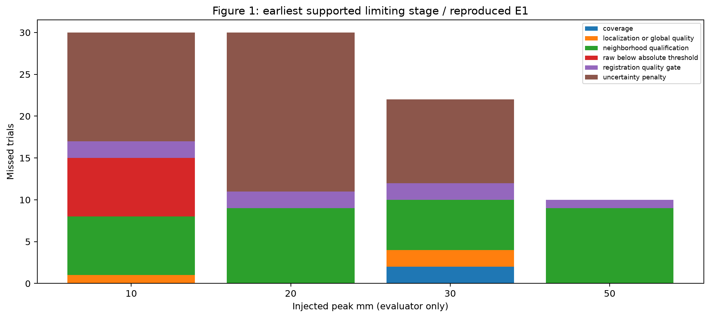
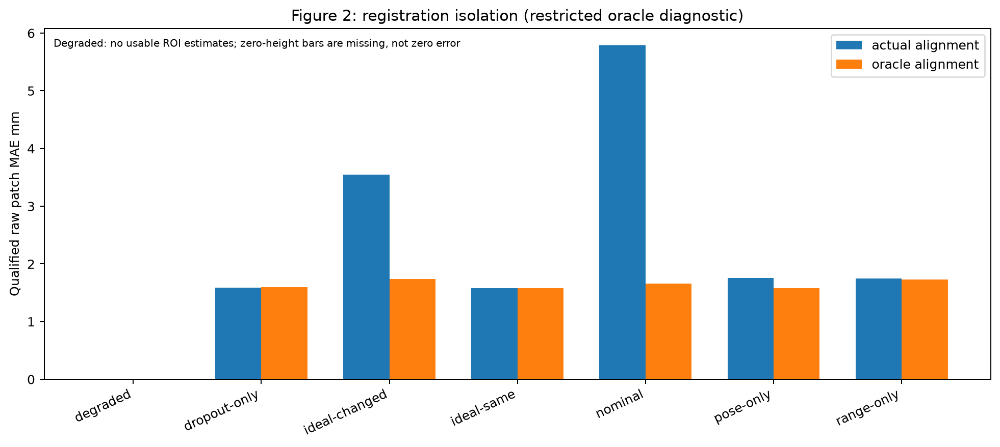
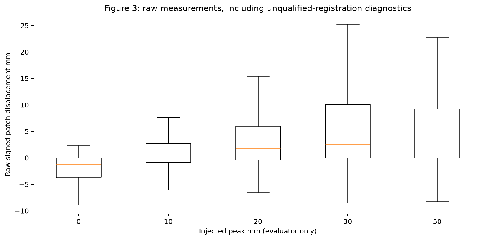
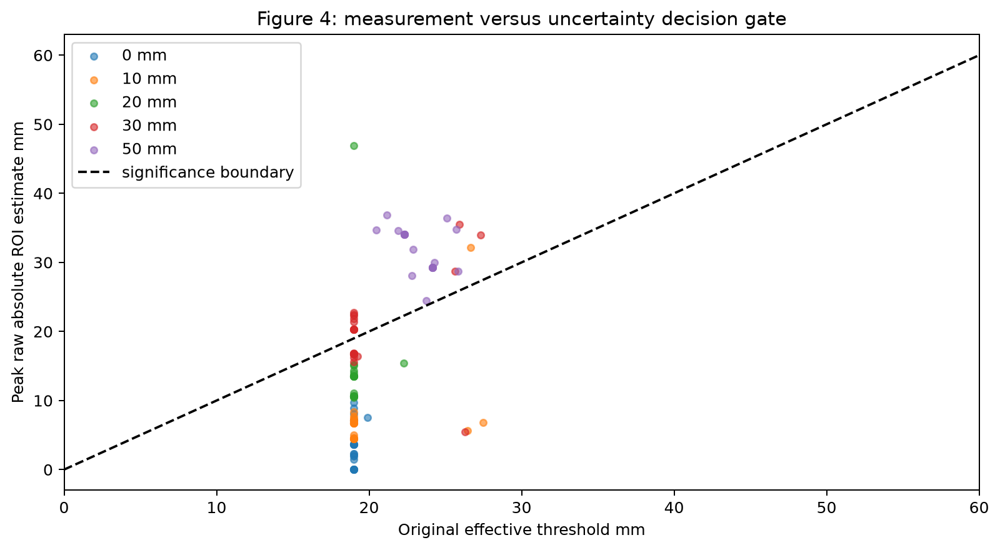
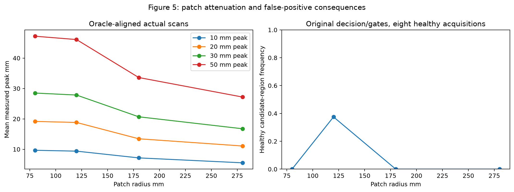
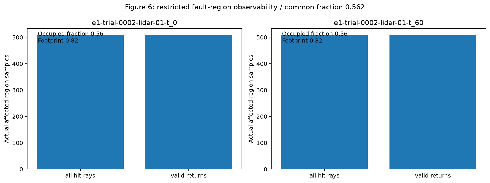
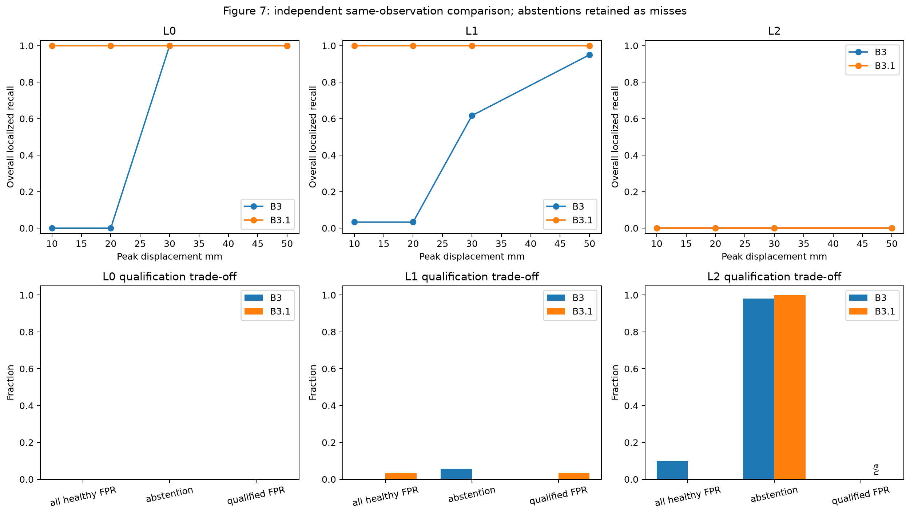
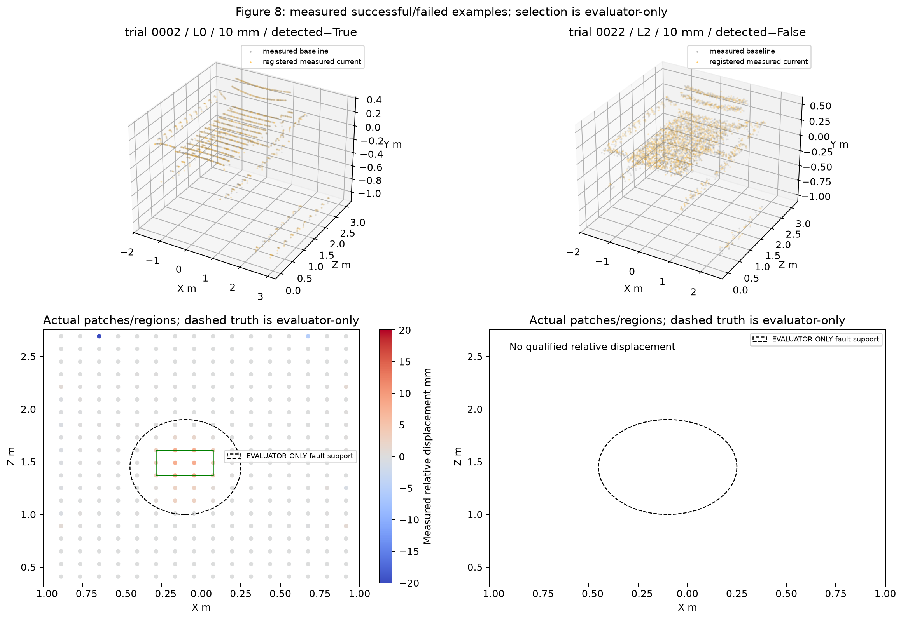

# Phase 3.1 independent validation

Executed 2026-10-27 on branch phase-3.1-geometric-improvement, software 0.4.1, CPU/headless Open3D 0.19. Baseline source: 775fc11; diagnostic checkpoint: f03c186; frozen production candidate: 92b5a53. Execution revision: 259c80078cbe9ee266a116662cba080e979d40f4. Full source/model hashes are in phase3_1/improved_freeze.json. No algorithm or calibration changes followed held-out evaluation. This is synthetic software evidence, not physical 10 mm LiDAR capability or an industrial safety qualification. No Phase 4 implementation was performed.

## A. Original baseline reproduction

The full original 154-pair E1 exactly reproduced B1/B2/B3 recall, region precision, healthy FPR, inconclusive fraction and mean registration translation error. B3 reproduced 0/30 (10 mm), 0/30 (20 mm), 11/33 (30 mm), 20/30 (50 mm), region precision 0.800, healthy alarms 0/30, inconclusive 35.065%, mean transform error 28.917 mm and healthy floor 9.325 mm. No discrepancy was found. Reproduction took 183.15 s. Baseline versioned records include settings, preset noise, thresholds, manifests/hashes, original Git SHA, seeds, errors and failures; their checksummed v1 record is retained unchanged.

## B. Evidence-supported root causes

The frozen PHASE3_1_ROOT_CAUSE.md contains full D1–D6 evidence and per-amplitude attribution. Main findings:

- The original uncertainty rule imposes about 19 mm minimum effective threshold from a 9.325 mm pooled healthy floor, before extra spread/registration penalties. At 20 mm, 19/30 misses had directly observed uncertainty suppression; ten also had no usable neighborhood and two had a registration gate. Contributors overlap and are not causal percentage allocations.
- On 140 diagnostic acquisitions, nominal qualified raw patch MAE fell from 5.791 to 1.660 mm with oracle alignment. Changed-view ideal errors also fell, while same-view ideal estimates were unchanged. Normal-direction transform effects are measured separately from full translation norms.
- Mean 10 mm peak estimates across supported oracle-aligned ideal/nominal cases were 9.670 mm at 80 mm radius, 9.388 mm at 120 mm, 7.167 mm at 180 mm and 5.548 mm at 280 mm. Smaller patches can create false candidates; 120 mm produced regions in 3/8 healthy diagnostic scans under the original rule. This motivated empirical spatial calibration rather than indiscriminate threshold reduction.
- All 20 degraded diagnostic cases lacked qualified ROI estimates even under true alignment. Region-level observability therefore does not imply local estimability; unchanged neighborhood gates remain important.
- Strict REF-01-only alignment failed conditioning in 40/40 tests despite hundreds of observed points. The diagnostic all-surface conventional ICP mean translation error was 2.963 mm versus robust all-surface 17.836 mm. This supports a scoped conventional-ICP choice, not universal superiority.

Unresolved cases retain multiple or uncertain causes. Per-triangle incidence was not retained and is reported unavailable; a labeled wall-prior incidence proxy, actual point spacing, peak-core counts and common-cell coverage are recorded privately.

## C. Implemented corrections

See PHASE3_1_IMPROVEMENTS.md for the equations. Original B3 and its registration modules remain byte-identical and selectable. B3.1 uses B2's conventional ICP with its quality gates, 80/120 mm qualified patches, robust broad wall-normal residual removal, per-location healthy bias/envelopes and a scan-level neighboring-pair threshold calibrated on separate healthy scans. Every B3.1 value is explicitly **localized_relative**; uniform/broad wall displacement may be removed and is outside this method's capability. The saved rigid transform is not silently improved by this relative correction. L2 and uncalibrated support motion abstain; the original methods remain available.

Calibration: 180 healthy pairs, seeds 2200–2229, three noise profiles and two views. First 15 seeds fit local envelopes; the remaining 15 calibrate the actual correlated spatial decision. Development: 300 pairs, seeds 2100–2109. The first candidate was retained without retuning after development. Its model and source hashes were frozen before generating/evaluating held-out cases. Diagnostic seeds 1100–1103 are also disjoint.

## D. Independent comparison

**930 unique held-out scan pairs:** 900 principal pairs (30 independent seeds x three fidelities x five amplitudes x two paired views) plus 30 L2 partial/high-pose/low-overlap stress pairs. All methods see exactly the same public pairs. There are 30 independent seeds per principal displacement/noise combination; two views from a seed are paired, not claimed as 60 independent replicates. Fault centers and extents vary under the predeclared partition rule, retaining the original peak amplitudes and compact deformation kernel. No sensor model/noise/pose error distribution was eased. Operating regime remains the original steady E1 regime; broader operating generalization is untested.

Aggregate table includes stress trials; the 30 mm row therefore has 210 positives rather than 180. There are 180 healthy controls. Failing, unobserved and inconclusive positive cases remain misses. Healthy FPR must be read with prediction coverage: an unflagged inconclusive negative is not established healthy.

| Metric | B1 | B2 | Original B3 | Improved B3.1 |
|---|---:|---:|---:|---:|
| Mean transform translation error mm | 42.462 | 34.395 | 242.335 | 34.395 |
| Mean rotation error deg | 0.572 | 0.391 | 1.665 | 0.391 |
| Registration failure fraction | 22.69% | 1.08% | 8.17% | 1.08% |
| Healthy false-positive rate | 72/180 (40.00%) | 76/180 (42.22%) | 6/180 (3.33%) | 2/180 (1.11%) |
| 10 mm localized recall | 20/180 (11.11%) | 10/180 (5.56%) | 2/180 (1.11%) | 120/180 (66.67%) |
| 20 mm localized recall | 32/180 (17.78%) | 13/180 (7.22%) | 2/180 (1.11%) | 120/180 (66.67%) |
| 30 mm localized recall | 37/210 (17.62%) | 13/210 (6.19%) | 97/210 (46.19%) | 120/210 (57.14%) |
| 50 mm localized recall | 110/180 (61.11%) | 120/180 (66.67%) | 117/180 (65.00%) | 120/180 (66.67%) |
| Region precision | 0.157 | 0.143 | 0.789 | 0.984 |
| Inconclusive fraction | 36.45% | 34.62% | 36.67% | 35.48% |
| Prediction coverage | 63.55% | 65.38% | 63.33% | 64.52% |
| Coverage-conditioned recall | 27.26% | 21.37% | 29.86% | 65.75% |
| Conditional recall among qualified trials | 42.16% | 32.10% | 46.19% | 100.00% |
| Mean logical pipeline runtime s | 0.189 | 0.267 | 0.205 | 0.321 |

B3.1 transform errors equal B2 because they share the same conventional solution; its relative correction does not establish absolute six-DOF registration accuracy. Runtime is measured registration plus geometry time per logical method. Combined execution reuses B2 registration for B3.1; these logical times must not be summed to infer actual wall time.

Principal same/changed-view results by fidelity (stress cases excluded below):

| Fidelity | Method | Healthy alarms /60 | 10 mm TP /60 | 20 mm TP /60 | 30 mm TP /60 | 50 mm TP /60 | Prediction coverage |
|---|---|---:|---:|---:|---:|---:|---:|
| L0 | B1 | 30/60 | 0/60 | 0/60 | 10/60 | 60/60 | 100.00% |
| L0 | B2 | 30/60 | 0/60 | 0/60 | 0/60 | 60/60 | 100.00% |
| L0 | B3 | 0/60 | 0/60 | 0/60 | 60/60 | 60/60 | 100.00% |
| L0 | B3.1 | 0/60 | 60/60 | 60/60 | 60/60 | 60/60 | 100.00% |
| L1 | B1 | 36/60 | 19/60 | 32/60 | 27/60 | 50/60 | 96.67% |
| L1 | B2 | 30/60 | 10/60 | 13/60 | 13/60 | 60/60 | 100.00% |
| L1 | B3 | 0/60 | 2/60 | 2/60 | 37/60 | 57/60 | 94.33% |
| L1 | B3.1 | 2/60 | 60/60 | 60/60 | 60/60 | 60/60 | 100.00% |
| L2 | B1 | 6/60 | 1/60 | 0/60 | 0/60 | 0/60 | 0.33% |
| L2 | B2 | 16/60 | 0/60 | 0/60 | 0/60 | 0/60 | 2.67% |
| L2 | B3 | 6/60 | 0/60 | 0/60 | 0/60 | 0/60 | 2.00% |
| L2 | B3.1 | 0/60 | 0/60 | 0/60 | 0/60 | 0/60 | 0.00% |

All by-viewpoint stress outcomes, qualified/unqualified counts, Wilson proportion intervals and missing-estimate counts are retained in heldout_results.json. Trial-level pairing is in trial_table.csv; comparison_table.csv gives every principal displacement/fidelity denominator. No difficult trials were removed.

Displacement errors below include healthy and faulty ROI patches independent of whether a region was detected. They compare normal-projected estimates to analytical field values at patch centers; finite patch support and relative detrending can contribute bias. Raw B3.1 errors are pre-common-mode estimates, while qualified corrected errors use the explicitly relative measurement. Unqualified estimates and missing values remain separately counted rather than silently excluded.

| Method | Raw MAE / RMSE / bias mm | Qualified corrected MAE / RMSE / bias mm | Unqualified estimates | Missing ROI estimates |
|---|---:|---:|---:|---:|
| B1 | 10.095 / 14.156 / 8.879 (n=22208) | 10.095 / 14.156 / 8.879 (n=22208) | 0 | 17572 |
| B2 | 6.630 / 9.768 / 4.798 (n=23641) | 6.630 / 9.768 / 4.798 (n=23641) | 0 | 16139 |
| B3 | 2.978 / 5.098 / -2.424 (n=23551) | 2.978 / 5.098 / -2.424 (n=23551) | 0 | 16229 |
| B3.1 | 2.070 / 3.139 / -1.202 (n=22696) | 1.522 / 2.373 / -0.080 (n=22454) | 242 | 17084 |

Paired differences, B3.1 minus original B3, with 2,000 seed-cluster bootstrap resamples (principal cases only):

- recall: 0.3639, bootstrap 95% range [0.35277777777777775, 0.375].
- healthy_fpr: -0.0222, bootstrap 95% range [-0.05, 0.0055555555555555575].
- inconclusive_fraction: -0.0122, bootstrap 95% range [-0.02333333333333333, -0.0022222222222222227].

These uncertainty ranges describe this controlled seed mixture. Engineering patch envelopes are not calibrated statistical intervals. Empirical coverage of the original engineering score is separately retained in JSON; B3.1 envelope coverage is a diagnostic of a healthy screening score, not a physical confidence claim. Local error summaries condition on measurable patches and cannot imply accuracy where no estimate exists. Matched-region centroid localization errors are retained per trial and in aggregate; they are conditioned on matches and failures remain in recall.

## E. Experimental integrity

The import boundary rejects plant, sensing-implementation, scenario-control and evaluator imports from production analytics. Public-only tests block private text and NPZ reads while B3/B3.1 run. Only restricted diagnostics/evaluation use true poses, injected fields or asset-hit labels. Predictions/registered clouds/configuration/model artifacts are saved and hashed before the evaluator opens truth. All 930 final prediction seals were reverified, and frozen production source hashes still match. The source calibration hash is checked and never updated in evaluation.

Execution was optimized using three isolated spawn processes with one OpenMP/BLAS thread each. 187 previously sealed sequential cases were reused unchanged; interrupted unsealed artifacts were preserved in a separate transition directory. Per-case deterministic RNG keys/seeds, geometry, observations and model are unchanged. The sequential script remains available; the resumable execution script and its hash are recorded. No detector changes followed partial or final held-out metrics. Filesystem isolation is procedural/code-level hygiene under one OS user, not a hostile-process security boundary.

## F. Remaining limits and readiness

Small-change sensitivity is demonstrated only for supported synthetic observations under the observed noise/view regimes. L2 local neighborhoods/calibration remain inadequate, producing unavailable/inconclusive evidence; no threshold adjustment was made to hide this. Sparse/occluded/low-overlap/high-pose cases retain qualifications. Uniform or broad wall displacement is intentionally outside B3.1's relative basis; original B3 remains available. Support displacement is not calibrated by this wall model. Synthetic accepted-reference and test scenes share a geometry source; independent surveyed geometry, real LiDAR calibration and relevant-environment tests are required. Limited noise-profile grouping is not a general instrument calibration model. No physical sensitivity, hazard severity, UAV optimization or Phase 4 fusion claim is made.

The contracts are suitable for future fusion provided it honors measurement_basis, model/calibration references, registration status, coverage, null estimates, achieved sensitivity and reinspection_candidate. A qualified local negative means no significant localized change under those conditions; it never certifies absent deformation or healthy boiler status. Fusion must preserve unavailable global/support evidence and cannot treat relative and absolute estimates interchangeably.

## G. Execution and artifacts

Held-out campaign wall time from candidate freeze through final metrics: 655.59 s (includes sequential/parallel transition and commit overhead). Parallel resume stage: 369.82 s. Maximum worker RSS: 692.1 MiB; sum of worker peaks is a conservative 2072.6 MiB envelope, not a simultaneous measured peak. Parent peak: 120.9 MiB. Healthy calibration runtime: 60.93 s; development comparison: 196.28 s.

Executed: 170 Pytest tests, Ruff lint/format, Mypy (67 source files), pip check, doctor, schema export, all-four-method CLI smoke, original E1 reproduction, diagnostics, calibration/development and full held-out comparison. Existing six-group E2 smoke regression also runs in this increment; full Phase 3 E2 is not presented as a new Phase 3.1 rerun. One pre-existing Starlette/httpx warning remains. The 0.4.1 minimal CPU API image builds and reaches Compose health; its endpoints return HTTP 200. This image deliberately excludes optional Open3D analytics dependencies and is not a full analytics-container claim.

Primary paths below are relative to /home/mallikarjun/workspace/TwinGuard:

- docs/PHASE3_1_ROOT_CAUSE.md; docs/PHASE3_1_IMPROVEMENTS.md; docs/PHASE3_1_VALIDATION.md
- docs/phase3_1/baseline_v1.json and baseline_v1.sha256; diagnostic_results.json; improved_freeze.json; b31_calibration_v1.json
- docs/phase3_1/heldout_results.json; comparison_table.csv; trial_table.csv; figure_source_data.json; checks.json
- experiments/outputs/phase3_1/baseline-reproduction: original public datasets and sealed B1/B2/B3 predictions
- experiments/outputs/phase3_1/diagnostics/restricted_traces and baseline-traces: evaluator-only oracle/true-field stage measurements
- experiments/outputs/phase3_1/development-data: immutable healthy/development public measurements and separate private contexts
- experiments/outputs/phase3_1/heldout-v1/datasets and predictions/trial-XXXX/B1|B2|B3|B3.1: manifests, measured/registered NPZ/PLY, registration.json, geometry.json and patches.npz
- output/phase31-cli-smoke: direct CLI output for all four methods

Large generated datasets/predictions remain ignored by Git; compact reports/source data/figures are versioned. For stage-by-stage commands see EXPERIMENTS.md and python scripts/phase31.py --help. The frozen candidate's sequential command is scripts/phase31_heldout.py; deterministic resume/parallel execution is scripts/phase31_parallel.py. A completed held-out report cannot be overwritten. Changing detector settings requires a newly declared untouched evaluation partition.

## H. Figures from actual measurements

## I. Completion decisions

PASS denotes the specified investigation/software capability, not unrestricted measurement performance.

| # | Criterion | Decision and evidence |
|---|---|---|
| 1 | Baseline reproduced | PASS: Exact original headline metrics, immutable source/settings/manifests |
| 2 | D1–D6 executed | PASS: 140 diagnostic pairs plus all 154 baseline traces; incidence limitation disclosed |
| 3 | Causes ranked from evidence | PASS: Measured oracle, scale, uncertainty, coverage and reference contrasts |
| 4 | Raw error versus decision rejection | PASS: T0/T1/T2/T3 traces and raw/qualified/unqualified accounting |
| 5 | Coverage versus detector failure | PASS: Private categories, common area and local quality distinguished |
| 6 | Root-cause report complete | PASS: Saved/hash-checkpointed before production corrections |
| 7 | Relevant corrections implemented | PASS: Calibrated multiscale wall-relative method, with scope limits |
| 8 | Original B3 preserved | PASS: Byte-identical original solver/detector, selectable CLI |
| 9 | No hidden truth in B3.1 | PASS: Import audit and protected private-read tests |
| 10 | Independent four-method comparison | PASS: 930 paired held-out acquisitions, frozen candidate |
| 11 | FPR/recall/abstention reported | PASS: Overall, conditional, by noise/amplitude/view; failures retained |
| 12 | Improvement and limits documented | PASS: Quantitative tables and explicit relative/L2 limitations |
| 13 | Actual figures/tables generated | PASS: Eight measured PNGs plus JSON/CSV source data |
| 14 | Tests/lint/types/build pass | PASS: 170 tests, Ruff, Mypy, dependencies and API build/smoke |
| 15 | Phase 4-suitable output contracts | PASS: Qualified relative/absolute semantics, calibration/coverage/unknown states; no fusion |

Overall task: PASS for implemented investigation and independent synthetic validation. Operational capability remains PARTIAL: L2, global/broad movement, support calibration and physical metrology are not established. No Phase 4 work was performed.

## Additional trade-offs and measurement exclusions

B3.1's 2/180 overall healthy alarms versus B3's 6/180 do not prove a population false-alarm reduction: the paired seed-bootstrap FPR difference interval includes zero. Among fully qualified healthy trials, original B3 has 0/117 alarms while B3.1 has 2/120 (1.67%). More small-change sensitivity therefore accompanies some qualified healthy alarms. Candidate regions from unqualified original analyses contribute to the all-negative alarm metric; abstention is not established health.

Positive-only matched-region centroid localization worsens from 48.0 mm (B3) to 103.4 mm (B3.1). More sensitive/wider regions and the different detected-amplitude mix limit comparability; better detection recall is not better localization accuracy.

Registration means include failed outputs. Original B3's held-out median translation error is 7.83 mm, valid-registration mean 18.32 mm, maximum 96,700 mm (rejected catastrophic divergence). Its aggregate 242.33 mm mean is not a typical valid error. B2/B3.1 share median 3.56 mm and valid-registration mean 13.81 mm. Extreme failures remain counted, and their clouds are untrustworthy alignments.

Only valid B3.1 patches carry calibrated localized-relative measurements. Unqualified patches can retain original raw diagnostic estimates without usable calibration; they must never enter fusion as corrected relative evidence. Figure 8 suppresses quantitative coloring for those patches. Consumers must check status, significance and calibration support.

The frozen healthy_manifest_sha256 field covers the whole development-data directory, including development faults; its historical name does not describe training. The calibration script filters only the 180 healthy-calibration cases, and training_datasets records those IDs. calibration_inputs_v1.json separates the healthy and development manifests. Neither development faults nor held-out scans fit the healthy model.
