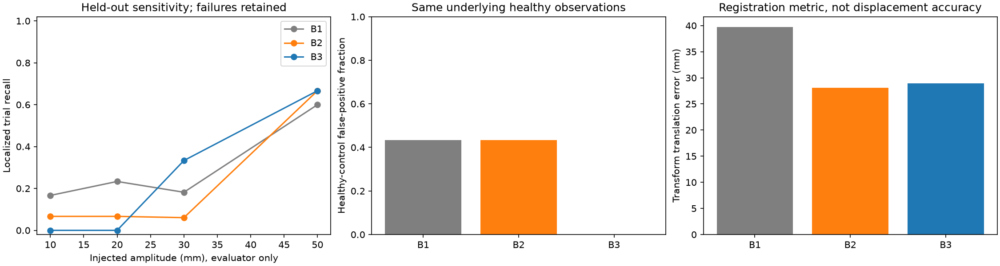
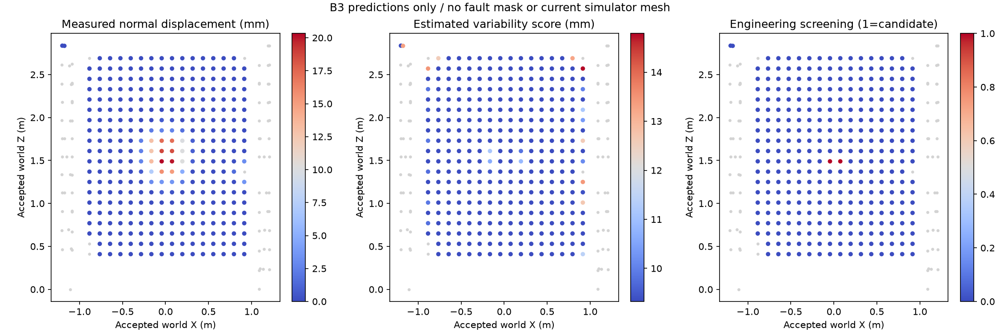
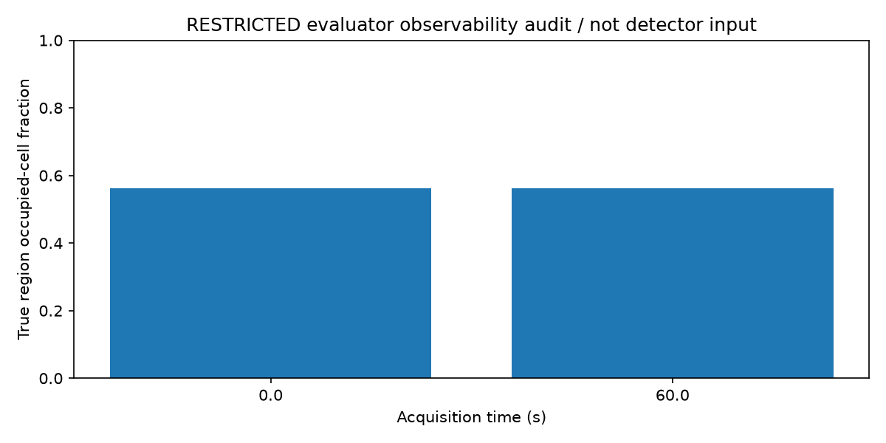
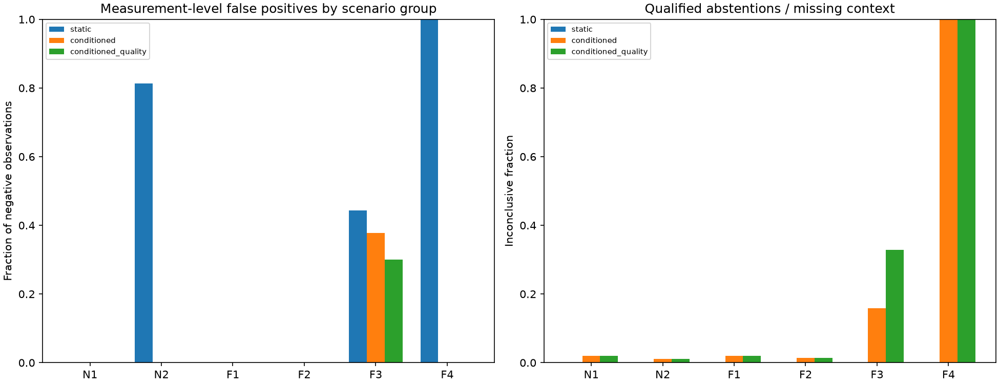
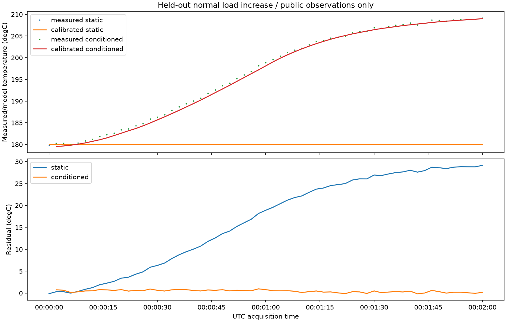
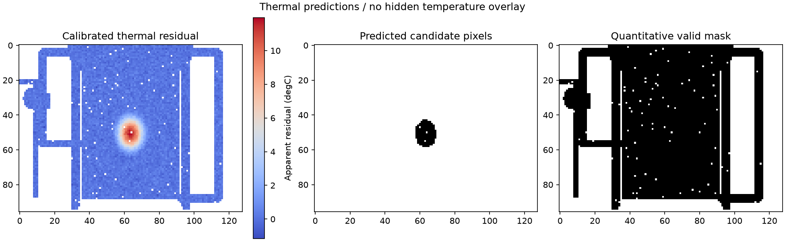

# Phase 3 validation and implementation report

Executed 2026-10-27 on branch `phase-3-analytics`, based on Phase 2 commit `8c57e65`. Software 0.4.0, schema 1.0.0; Python 3.12.3, Open3D 0.19, CPU/headless. Working-tree changes are intentionally uncommitted. This is synthetic software validation, not physical accuracy, industrial readiness or a TRL certification.

## Repository and Phase 2 corrections (A–B)

See PHASE3_CHANGES.md for the file inventory. The public thermal payload adds saturation_mask and pixel_status with conservative legacy support. Private LiDAR references now retain all hit rays separately from valid returns. The evaluator audits actual deformation-region rays, valid samples, density, projected footprint and common occupied cells; a real opaque-surface regression verifies that hidden deformation produces zero returns. Public analytics never receives this ROI or uses intended target IDs for segmentation. Association uses a fixed accepted synthetic as-built reference. Sensor range error, estimated registration error and detection/displacement error are separate quantities. Earlier Phase 2 reports remain historical snapshots.

## Registration and E1 (C–D)

The full matrix contains 150 primary cases: five held-out seeds x three noise fidelities x five amplitudes (0/10/20/30/50 mm) x two viewpoints, plus three stress cases and one support case = **154 independent scan pairs**. Each method sees identical observations. Five independent healthy calibration pairs use seeds 50–54; held-out seeds are 200–204. Low overlap, high pose error and partial view are explicit stress cases. Fidelity levels follow the existing assumed sensing model.

| Method | Mean translation error mm | Mean rotation error deg | Registration failure % | Region precision | Localized recall | Healthy false alarms | Patch displacement MAE mm |
|---|---:|---:|---:|---:|---:|---:|---:|
| B1 | 39.71 | 0.581 | 20.78 | 0.189 | 36/124 (29.0%) | 13/30 | 10.64 |
| B2 | 28.06 | 0.328 | 0.65 | 0.166 | 26/124 (21.0%) | 13/30 | 6.49 |
| B3 | 28.92 | 0.600 | 6.49 | 0.800 | 31/124 (25.0%) | 0/30 | 2.96 |

B1 = reported poses + fixed NN; B2 = conventional point-to-point ICP + fixed NN; B3 = robust multiscale point-to-plane ICP + patch uncertainty screening. B3 lowers false alarms and improves qualified displacement estimates, but conventional ICP has slightly lower mean translation error and fewer registration rejections. No uniform registration superiority is claimed. Aggregate transform errors include failed outputs; they are not sensor range RMSE or local displacement error. Sensor range RMSE is independently recorded for every case in the JSON.

B3 overall recall is 31/124 = 25.0% (Wilson 95% interval 18.2–33.3%). Its 0/30 healthy false alarms have a Wilson upper bound of 11.4%, not proof of zero population risk. Eleven healthy B3 trials abstained; only 19/30 healthy cases had fully qualified geometric results, with 0/19 false alarms. Total B3 inconclusive fraction is 35.1%. B1/B2 each produced 13/30 healthy alarms, including candidate regions from unqualified analyses; fully qualified healthy FPRs are 13/20 and 11/21 respectively. Non-alerting abstentions are not health certificates, even though the binary confusion table counts them as unflagged negatives.

B3 amplitude recall: 10 mm 0/30, 20 mm 0/30, 30 mm 11/33 (includes three stress trials), 50 mm 20/30. The support case is reported separately; no waterwall observability claim is applied to it. Observable-only B3 recall is 31/121 = 25.6%; unobservable positives remain in the overall denominator. Region precision is 32/(32+8)=0.800; event precision is a separate field. Mean matched-region centroid error is 55.8 mm. Qualified-patch MAE is 2.96 mm; conservative engineering-score empirical coverage is 99.47%, explicitly not a calibrated 95% interval. Conditioning on qualified patches biases these error summaries toward measurable surfaces. Registration quality checks do not catch every local minimum.





## E2 operating, thermal and quality results (E)

Nine healthy training sequences (three seeds x steady/increase/decrease) precede 30 held-out sequences (five seeds x six groups). Each held-out sequence contributes five thermal frames: **150 frames** in total, with measured IoT streams. Static, conditioned and quality-aware operating variants share observations and calibration collection. Five repeated trials per group are preserved, including delays and unit-specific residual RMSE; sample-wise observations are temporally correlated and are not independent population trials.

| Group | Static operating FPR | Conditioned FPR | Quality-aware FPR | Conditioned abstention | Quality-aware abstention |
|---|---:|---:|---:|---:|---:|
| N1 | 0.0% | 0.0% | 0.0% | 2.0% | 2.0% |
| N2 | 81.3% | 0.0% | 0.0% | 1.0% | 1.0% |
| F1 | 0.0% | 0.0% | 0.0% | 2.0% | 2.0% |
| F2 | 0.0% | 0.0% | 0.0% | 1.4% | 1.4% |
| F3 | 44.4% | 37.8% | 30.0% | 15.9% | 32.8% |
| F4 | 100.0% | 0.0% | 0.0% | 100.0% | 100.0% |

N1 is steady healthy; N2 is a normal load increase; F1 is a hotspot; F2 is a process-pressure deviation; F3 is healthy plant with degraded sensors; F4 is a legitimate load beyond the calibration range. N2 static false alarms fall from 81.3% to 0% with conditioning, with 1.0% abstention. This supports state conditioning under these simulated regimes. F1 and F2 operating recall are 1.0 in all five trials and all three methods. F1 first-detection delay ranges 0.0005–5.0000 s; F2 ranges 0.0006–1.0046 s. These are acquisition-based delays, not end-to-end service latency.

F3 residual alarms may detect sensor corruption rather than plant damage: quality filtering reduces the plant-label FPR from 37.8% to 30.0%, while abstention rises from 15.9% to 32.8%. These are not equipment-fault classification results. F4 conditioned FPR=0 accompanies **100% out-of-range abstention**, not successful healthy classification.

Thermal N2 static FPR is 20/25=80%; conditioned FPR is 0/25 with 8% inconclusive. F1 has 15 positive and 10 negative thermal frames; both variants detect all 15 positives without false regions on negative frames. Conditioned positive mean mask IoU is 0.439 and qualified anomaly-residual MAE is 0.251 C. F3 has 50.9% saturated pixels and only 7.6% quantitative pixels: all 25 frames are inconclusive. F4 also has 25/25 inconclusive thermal frames due to reference range. N1/F1/F2 each have 16% thermal abstention from context/quality gates. Image regions are not automatically assigned plant asset identities.





## Integrity, artifacts and reproduction (F)

Inference loads only manifest-declared public observations and allowlisted arrays. Import-boundary checks prohibit plant, sensing implementation, scenario configuration and evaluator imports from analytics. Predictions, configuration and input hashes are persisted in predictions_ready.json before the evaluator reads private poses or faults; tampered output is rejected. This is procedural/code isolation plus filesystem permissions, not security against another process using the same OS identity. Calibration and test seed overlap is rejected. Algorithms do not update on held-out data. Opaque case IDs do not encode faults.

Full E1 output: experiments/outputs/phase3-full/E1. The finalized prediction_directory in report.json points to predictions-export/<opaque-case>/B1|B2|B3. Each contains registration.json, geometry.json, patches.npz and registered_current.ply; the enclosing directory contains the seal and fixed configuration/reference/calibration. Source now also writes registered_current.npz with its frame/hash. Original predictions and qualification replays remain intact. Replays added asset-coverage/export metadata using unchanged numerical settings, with new seals before evaluation; they did not tune thresholds on outcomes.

Full E2 output: experiments/outputs/phase3-full/E2, predictions/<opaque-case> contains operating-*.json, conditioned/ and static/ thermal JSON/NPZ records, residual arrays and a seal. Model directories and frozen calibration data remain beside the datasets. Public datasets have observations/ and manifest.json; evaluator-only data is under evaluation_private/. Generated large artifacts are ignored by Git. Small reports and figures are checked into docs/phase3_e1_results.json, docs/phase3_e2_results.json and docs/figures/phase3_*.png. Full artifacts are local, not embedded in this report.

```bash
pip install -e '.[dev,viz,sensing,analytics]'
export OMP_NUM_THREADS=1 OPENBLAS_NUM_THREADS=1
twinguard experiment run E1 --config experiments/E1.yaml --output-dir experiments/outputs/new-E1
twinguard experiment run E2 --config experiments/E2.yaml --output-dir experiments/outputs/new-E2
twinguard experiment report --run-dir experiments/outputs/new-E1
twinguard experiment report --run-dir experiments/outputs/new-E2
# For smaller matrices add --smoke; do not mix their metrics with full runs.
```

Configuration definitions are experiments/E1.yaml and E2.yaml with configs/experiments/E1.yaml and E2.yaml, accepted_reference.json and typed AnalyticsConfig defaults. Seeds, per-case scenarios, sensor presets, software/base Git revision, frozen configuration/model hashes and measured runtimes are preserved. Frozen algorithm.json records resolved defaults; changing library versions can change Open3D numerics. Inference signal outputs are reproducible; runtime/timestamps are volatile. Full E1 generation/inference plus qualification replay took 276.43 s (reported peak 692.5 MiB); E2 generation/inference/evaluation took 96.30 s (peak 718.3 MiB). Later metadata-only sealing/review time is not included. These are whole-process peaks including simulation and evaluation, not isolated algorithm memory claims.

## Checks (G)

The initial Phase 0–2 baseline passed 148 tests. The final suite passes **160 tests**, with one pre-existing Starlette/httpx deprecation warning. Existing API maturity assertions were updated to require registration as implemented and fusion as pending; original behavioral regression coverage remains. Ruff lint and formatting pass across src/tests/scripts; Mypy passes all 62 source files; pip check passes. Editable 0.4.0 installation and JSON schema export succeed. The CPU API Docker image builds and reached Compose healthy status; /health, /version (0.4.0) and /capabilities returned HTTP 200. Temporary services and mirror were stopped. its optional-free image is not a claim that full Open3D analytics is containerized. CPU analytics execute with one OpenMP/BLAS thread. See phase3_scenario_smoke.json for S0–S4 public ingestion/geometry checks, including conservative handling of legacy thermal formats.

Unit tests cover known rigid transformations, planar ambiguity, preprocessing, opposite surfaces, signed 30 mm displacement, healthy/missing patches, causal load dynamics, future-data exclusion, saturation/legacy handling, private-read isolation, actual occlusion, seal tampering and calibration split rejection. E1 adds partial/low-overlap/high-pose stress, E2 adds delay/dropout/saturation/OOR stress. Sensing-model suites retain noise/occlusion tests. No GPU, physical sensor, Python 3.11, E3 or E4 execution is claimed.

## Limits and Phase 4 readiness (H–I)

This demonstrates a qualified synthetic analytics engine, with limited small-deformation sensitivity. Reference and simulated scenes share synthetic geometry, so physical generalization is unproven. Repetitive/planar surfaces, incomplete views, sparse stable targets and calibration mismatch can leave plausible registration bias. Conservative uncertainty is an engineering score, not a calibrated probability. Thermal supports similar viewpoints and assumes the existing simplified radiometry. Operating fits cover measured healthy loads; unseen regimes abstain. Five repeated seeds per cell/group are limited evidence, not population validation. Sensor-model correctness and downstream fault detection are distinct claims.

Phase 4 can consume RegistrationResult, PatchEstimate, GeometryRegion/Result, OperatingPrediction and ThermalRegion/Result, including nullable values, provenance, times, coverage, units, model IDs and quality flags; the operating evidence adapter emits the existing EvidenceRecord. An empty region list is insufficient to infer health. Association and detection confidence remain qualified. Fusion, severity, inspection policy, industrial messaging and dashboard remain unimplemented.

## Acceptance decisions (J)

PASS here means the specified software capability was implemented and exercised under synthetic assumptions; it does not establish unrestricted sensitivity or physical validation.

| # | Criterion | Decision / evidence |
|---|---|---|
| 1 | Phase 0–2 regression | PASS: 160 tests; two maturity assertions updated |
| 2 | Deformation observability | PASS: All-hit/valid/common-cell audit and opaque screen test |
| 3 | Thermal saturation | PASS: Per-pixel saturation/status, conservative legacy |
| 4 | No perfect target segmentation | PASS: Fixed accepted reference only |
| 5 | Separate sensing/detection accuracy | PASS: Per-case sensor RMSE, transform and displacement metrics |
| 6 | Public cloud validation | PASS: Manifest/checksum/frame/array loaders |
| 7 | Conventional ICP | PASS: Actual Open3D point-to-point |
| 8 | Robust ICP | PASS: Tukey multiscale point-to-plane |
| 9 | Reported poses and geometry only | PASS: No true pose or correspondence IDs |
| 10 | Failure/ambiguity handling | PASS: Quality gates and actual stress failures; imperfect gates documented |
| 11 | Registered export | PASS: PLY plus explicit transform/frame; current source NPZ |
| 12 | Fixed geometric baseline | PASS: B1/B2 fixed NN |
| 13 | Patch detector | PASS: Common-coverage oriented median patches |
| 14 | Uncertainty/quality | PASS: Conservative engineering scores; no nominal CI claim |
| 15 | Missing coverage inconclusive | PASS: Per-patch and per-asset statuses |
| 16 | Asset association | PASS: Qualified unique accepted-volume association |
| 17 | E1 repeated healthy/faulty | PASS: 154 pairs; five held-out seeds |
| 18 | E1 actual comparison | PASS: Precision/recall/FPR/error/runtime and abstentions |
| 19 | Numeric thermal input | PASS: Radiometric arrays, not color images |
| 20 | Invalid/saturated exclusion | PASS: Quantitative masks and status gates |
| 21 | Thermal residual regions | PASS: 15/15 positive frames; IoU reported |
| 22 | Static reference | PASS: Healthy steady calibration subset |
| 23 | Conditioned reference | PASS: Causal dynamic measured-load regression |
| 24 | Fault-free model calibration | PASS: Separate healthy seeds and frozen model |
| 25 | E2 normal/abnormal regimes | PASS: 30 sequences, six groups |
| 26 | E2 actual comparison | PASS: FPR/recall/delay/thermal/quality results |
| 27 | Restricted truth access | PASS: Sealed predictions before evaluator; boundary/tamper tests |
| 28 | Configs and seeds | PASS: Frozen JSON, benchmark configs, dataset provenance |
| 29 | Actual result figures | PASS: Six measured PNGs reviewed |
| 30 | Quantitative documentation | PASS: This report and machine-readable rows |
| 31 | Lint/type/tests | PASS: Ruff/format/Mypy/pip check and 160 tests |
| 32 | Phase 4 interface readiness | PASS: Structured public results and evidence adapter; no fusion |

All 32 implementation criteria pass within the stated synthetic scope. Operational capability remains partial: reliable 10–20 mm detection, arbitrary-view thermal inference, physical calibration and final hazard decisions are not demonstrated. No Phase 4 work was performed.

The healthy geometric calibration retained 1,136 qualified patches and froze a 9.325 mm residual floor. Before additional registration/roughness penalties, the default screen thus requires about 19 mm displacement. A compact fault peak is attenuated within a finite patch. Thresholds were not relaxed after held-out failures.

All six analytics CLI subcommands executed successfully into output/phase3-cli-smoke: register, geometry, calibrate-operating, calibrate-thermal, operating and thermal. S0–S4 operating inference and available imaging records appear in phase3_scenario_smoke.json. Their legacy Phase 2 thermal arrays correctly abstain. S2's actual LiDAR pair passes all three pipelines. Repeated public-only inference is checked for equal estimated transforms and patch displacements, excluding volatile runtime fields.

Concrete review locations (relative to /home/mallikarjun/workspace/TwinGuard):

- experiments/outputs/phase3-full/E1/predictions-export/e1-trial-0001/B3/registered_current.ply
- experiments/outputs/phase3-full/E1/predictions-export/e1-trial-0001/B3/registration.json and geometry.json
- experiments/outputs/phase3-full/E1/report.json and E2/report.json
- experiments/outputs/phase3-full/E2/models/operating_model.json and thermal_model.npz
- output/phase3-cli-smoke/thermal/thermal.json
- output/phase3-cli-smoke/geometry/B3/registered_current.npz

Direct measured-cloud example (new output directory required):

```bash
twinguard analytics geometry \
  --baseline experiments/outputs/phase3-full/E1/datasets/e1-trial-0001/observations/lidar/e1-trial-0001-lidar-01-t_0.npz \
  --current experiments/outputs/phase3-full/E1/datasets/e1-trial-0001/observations/lidar/e1-trial-0001-lidar-01-t_60.npz \
  --config configs/analytics/default.yaml \
  --reference configs/analytics/accepted_reference.json \
  --output-dir output/new-geometry
```
