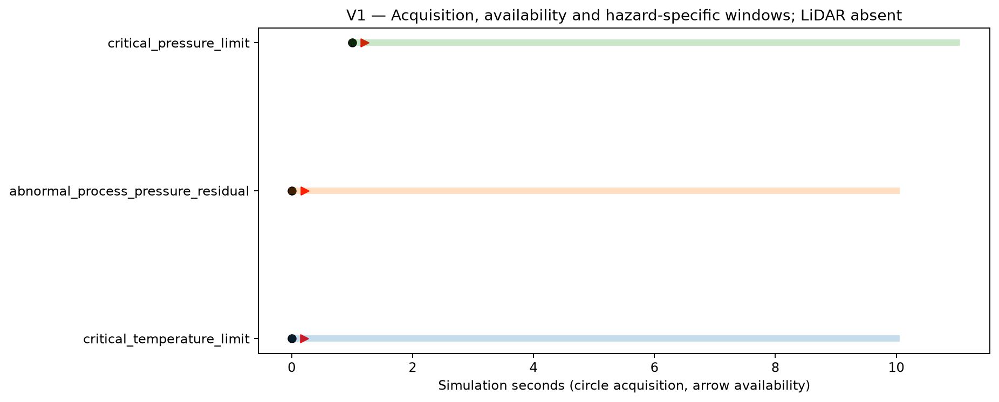
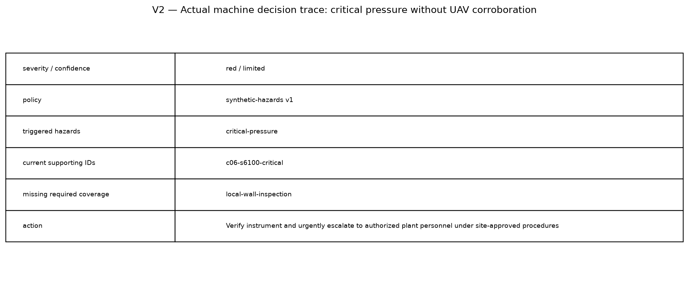
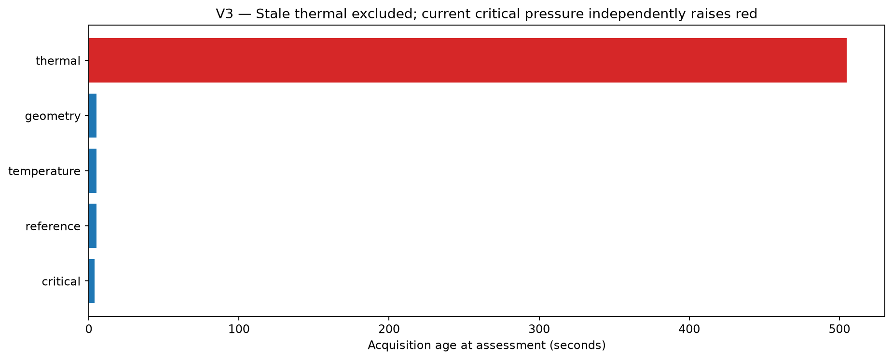
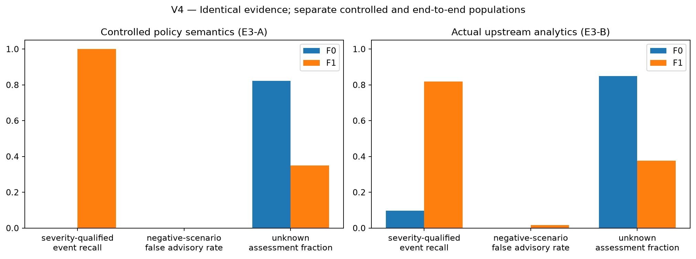
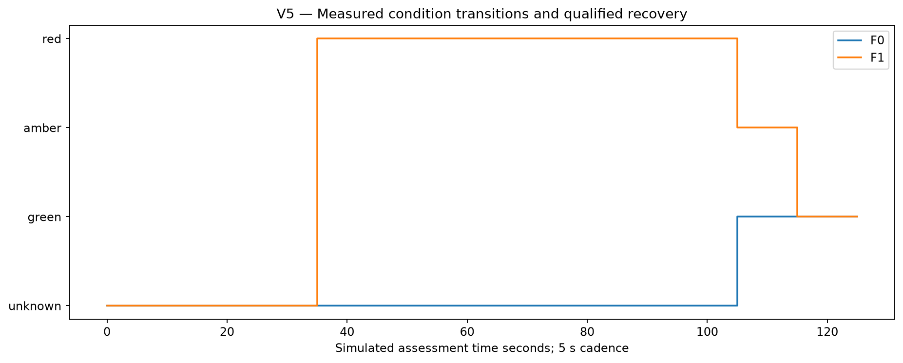
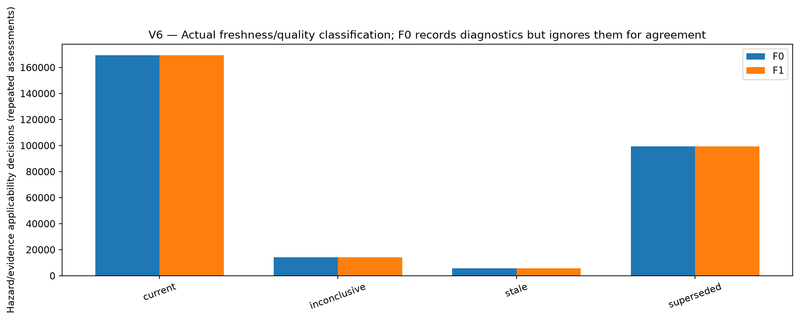
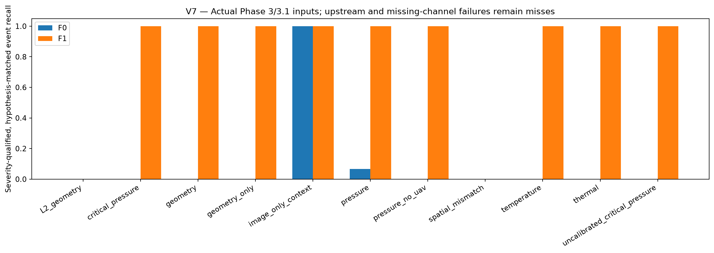

# Phase 4 validation — hazard-aware temporal evidence fusion

Completed 2026-10-28 (Asia/Calcutta). Branch phase-4-evidence-fusion; software 0.5.0, schema 1.0.0. Starting Phase 3.1 commit d99075f; first frozen E3 candidate dd20acd; representation/checkpoint correction a4552c4; final persistence validation 4296580. Initial and revised source hashes, policies, models and artifacts are preserved. This is an advisory research implementation and synthetic software validation, not physical boiler safety certification. Phase 5 was not implemented.

## Implemented architecture and Phase 3 compatibility (A–C)

New fusion modules implement validated public evidence/processing/policy/state contracts, geometric/thermal/IoT adapters, hazard-specific temporal checks, asset/physical-region compatibility, source dependence, F1 hazard assessment, fixed F0 agreement, persistent advisory lifecycle, explanations, public CLI and deterministic JSON checkpoint replay. Detailed guides: FUSION_ARCHITECTURE.md, EVIDENCE_SEMANTICS.md, HAZARD_POLICIES.md and EVENT_LIFECYCLE.md. Existing ConditionAssessment and Phase 3 records keep their meanings; exported schemas are additive.

B3.1 retains localized_relative scope, registration/calibration/coverage/support and reinspection flags. Unqualified raw patches never become valid findings. Unavailable support or L2 geometry is inconclusive, never negative. Image-only thermal findings are inspection-context advisories and cannot satisfy region corroboration. Installed surface-temperature and bulk process-temperature residuals are distinct. Operating anomalies are not automatically critical events. Configured current credible raw limit crossings can raise red without UAV agreement or an in-range operating model; invalid instruments cannot.

The illustrative pressure limit 1,150,000 Pa and temperature limit 240 degC are based on explicitly documented synthetic nominal envelopes, not learned fault labels or real safety limits. The site-review template has no critical limits and unknown instrument calibration. Policy thresholds did not change after final E3 evaluation. Clock/processing assumptions are explicit simulated_replay metadata; original offline analytics availability is never silently replaced by acquisition time. The prepare CLI uses actual seal completion and defaults clocks to unknown.

## Dataset separation and execution

E3-A: 22 designed logical cases x 30 independently seeded delivery variants (6100–6129), **660 cases**. These stipulate analytic finding/quality conditions and test policy semantics; they are not 660 physical experiments. Development used separate 5900/6900 and earlier 6000/7000 smoke inputs. Initial development policy errors and corrections are retained in phase4/development_policy_review.json.

E3-B: 15 comparative conditions x 30 fresh seeds (7100–7129), **450 actual generated sensor/analytics cases**. All use the original plant/sensor/analytics algorithms and frozen healthy Phase 3 models. Each acquired case contains two LiDAR and five thermal captures plus public IoT streams. A genuine historical public inspection is separately versioned for stale-history cases. Only the declared delivery selections are filtered/duplicated; detectors, noise and fault kernels were not eased. Models were not refitted on E3 labels.

F0/F1 receive identical evidence and availability schedules. Assessment cadence is five simulated seconds through 125 s. Critical pressure uses a clearly identified severe 500 kPa synthetic scenario; the existing 200 kPa anomaly remains noncritical. The temperature scenario adds 70 degC. All analytical availability assumptions and the matching horizon were fixed before evaluation.

Each method's assessments, traces, state, events and normalized snapshot were saved and SHA256-sealed before evaluation labels were read. After a policy JSON-roundtrip hash issue and explanation wording defect were found, **all 2,220 case-method streams were replayed**. Exactly **244,800 per-asset assessments** retained every semantic assessment field, selected/current/historical evidence, temporal/spatial/dependence findings, event states and actions. Notice records also match exactly. A custom-policy test also verifies that a qualified normal resets a pending consecutive-activation candidate; shipped rules and all E3 decisions remain unchanged. Only canonical IDs/hashes and explanation text changed in this corpus. This added no independent sensor observations and did not tune policies. Original outputs remain in phase4-full; final validated outputs are in phase4-validated.

## E3-A controlled policy-semantic results (D)

| Metric | F0 | F1 |
|---|---:|---:|
| Final expected decision | 240/660 | 660/660 |
| Severity-qualified event recall | 0.00% | 100.00% |
| Configured critical escalation | 0/270 | 270/270 |
| False advisories on negative logical scenarios | 0/240 | 0/240 |
| Unknown assessment fraction | 82.22% | 35.03% |
| Current support with no eligible hazard rule | 210 | 0 |

F1 meets all 22 expected final policy properties in all 30 delivery variants. Final-label correctness differs from event detection: the recovery scenario can end green even if a method failed to escalate the earlier critical event. Controlled success establishes semantics under designed evidence, not real upstream detection capability.

## E3-B end-to-end results and F0/F1 tradeoff (E–F)

There are 330 positive principal-event scenarios and 120 negative scenarios. Events must match the hypothesis and graded asset/scope within the fixed window; critical events require red. Geometry additionally needs a qualified supporting region in the private true footprint. An unrelated pressure warning cannot count as a detected L2 deformation.

| Metric | F0 | F1 |
|---|---:|---:|
| Severity-qualified event precision | 100.00% | 83.08% |
| Principal-event recall | 32/330 (9.70%) | 270/330 (81.82%) |
| Missed principal events | 298 | 60 |
| Critical escalation | 0/150 | 120/150 |
| Advisory rate on negative scenarios | 0.00% | 1.67% |
| Unmatched principal-event advisories | 0 | 53 |
| Unknown assessment fraction | 84.93% | 37.59% |
| Current support with no eligible rule | 5 | 0 |
| Complete provenance/rationale/support trace | 100.00% | 100.00% |

F1 has two false advisory scenarios among 120 negatives (one load-transition case and one missing/duplicate case); these are amber warnings, not false critical events. F0's high precision accompanies very low recall. Unknown is separately reported and is not a correct healthy negative. The strict primary-event precision penalizes unmatched warnings: F1's 53 include 30 real secondary geometric warnings in the spatial-mismatch cases where the principal critical temperature event was missed, plus 23 L2 cases with unrelated process warnings. Thus this is not a claim that all 53 warnings were physically nonexistent. Secondary/nonprincipal events are retained but not completely annotated; broader multi-event precision needs an expanded truth scheme.

| Condition | Cases per method | F0 detected | F1 detected | Interpretation |
|---|---:|---:|---:|---|
| L2_geometry | 30 | 0 | 0 | Upstream abstention remains missed geometry, not healthy |
| critical_pressure | 30 | 0 | 30 | Credible 500 kPa critical scenario |
| geometry | 30 | 0 | 30 | Real 20 mm localized change; no need for abnormal process signals |
| geometry_only | 30 | 0 | 30 | Geometric positive with fixed streams unavailable |
| healthy | 30 | 0 | 0 | No physical event; scoped green after required coverage arrives |
| image_only_context | 30 | 30 | 30 | Qualified localized geometry plus unassociated thermal context |
| missing_duplicate | 30 | 0 | 1 | Unknown monitoring and retransmissions; no duplicate confirmations |
| normal_load | 30 | 0 | 1 | Normal transition; retain observed false warnings |
| pressure | 30 | 2 | 30 | Noncritical 200 kPa deviation; amber, not invented critical |
| pressure_no_uav | 30 | 0 | 30 | Critical event must not wait for UAV |
| spatial_mismatch | 30 | 0 | 0 | Relevant critical channel absent; unrelated pipe warning cannot establish BW critical event |
| stale_inspection | 30 | 0 | 0 | Old actual inspection cannot establish current coverage |
| temperature | 30 | 0 | 30 | 70 degC critical process-temperature scenario |
| thermal | 30 | 0 | 30 | Actual hotspot; evaluated at image/inspection context, not exact asset overlap |
| uncalibrated_critical_pressure | 30 | 0 | 30 | Raw critical path still works outside learned operating range |

F1's 60 principal misses consist of all 30 L2 geometric events and all 30 missing-relevant-channel spatial-mismatch critical events. Five L2 cases end amber due to unrelated process warnings and 25 end unknown; none is counted as a successfully detected deformation. All 30 pressure-without-UAV and all 30 out-of-reference critical-pressure cases escalate correctly. Source faults and sensor/model quality failures are visible rather than relabeled healthy.

The paired seed-cluster recall difference F1−F0 is 0.7212, with a 2,000-resample descriptive 95% range [0.712121212121212, 0.7272727272727271]. Conditions within a seed remain paired. These are controlled synthetic-mixture intervals, not industrial reliability or calibrated evidence-confidence probabilities.

## Temporal, spatial, dependence and lifecycle audit

Current and historical support are separate. F1 has zero measured current support without an eligible triggered rule; persistent historical advisories are not treated as current corroboration. Image-only findings never establish confirmed region overlap. Alternate B3/B3.1 and raw/residual versions from one source do not become independent confirmations. Exact repeats do not issue duplicate open notices. Acknowledgment does not clear an event; expiration or loss of sensing does not prove recovery. Recorded repair invalidates older geometry, and qualified recovery uses new normal acquisitions, duration and hysteresis.

All 2220 final prediction seals were reverified. Repeated open-notice IDs: F0=0, F1=0. The graded-scope supplemental audit finds F0 green on scopes with no configured normal coverage in 300 controlled and 240 end-to-end assessment frames; F1 has zero in both tracks. These are repeated frames, not independent event counts. The original declared-missing-requirement green metric is zero for both and does not alone cover this unconfigured-scope failure.
Measured F1 clearing from first qualified recovery acquisition spans 5.993–11.009 s across 150 resolved critical events. This measures configured recovery waiting/cadence, not physical full-return latency. Unresolved/censored events are not scored as cleared; F0 has no comparable qualified-recovery rule.

Initial coarse audit fields incorrectly counted an evidence ID stale if any other rule had a shorter TTL, and treated historical persistence as missing explanation support. The validated audit checks eligibility under actual triggered rules and accepts explicitly labeled historical support for unresolved events. This is an audit correction only: event matching, classification and all decisions are unchanged, with original reports preserved.

## Performance and checks (G)

Original full generation/sensing/analytics/fusion run: 466.43 s. Complete decision-equivalence replay: 104.02 s. Peak original worker RSS 704.4 MiB; replay worker peak 118.2 MiB; these are per-process, not simultaneous whole-system peaks. Three isolated CPU workers, one OpenMP/BLAS thread each; no CUDA.

- F0: mean 125 s/26-tick replay CPU time 0.1887 s per case; average per all-asset assessment tick 0.007259 s. This is measured replay processing, not a transport SLA or per-message p99.
- F1: mean 125 s/26-tick replay CPU time 0.1914 s per case; average per all-asset assessment tick 0.007360 s. This is measured replay processing, not a transport SLA or per-message p99.

The initial Phase 0–3.1 baseline passed 170 tests. Final suite: **227 passed**, one pre-existing Starlette/httpx warning. Phase 0 maturity assertions now require implemented fusion/E3; prior behavioral tests remain. Ruff lint/format, Mypy (81 source files), pip check, doctor, schema export, policy/prepare/assess/replay/report CLI round trips and policy checkpoint JSON reload pass. The 0.5.0 CPU metadata API image builds, reaches Compose healthy and returns HTTP 200 for health/version/capabilities. It excludes optional Open3D analytics runtime and is not a full analytics-image claim. Temporary stack/mirror are stopped after checks.

## Exact artifacts and reproduction (H)

All paths below are relative to /home/mallikarjun/workspace/TwinGuard:

- configs/fusion/hazards.yaml and site-template.yaml: illustrative policy and unconfigured site template
- configs/fusion/calibration and history: frozen healthy models and actual historical public inspection
- configs/experiments/E3.yaml and experiments/E3.yaml: seeded execution/matching configuration
- experiments/outputs/phase4-full: original public observations, actual analytics, initial sealed predictions and separate evaluator labels
- experiments/outputs/phase4-validated: final public snapshots/manifests, state/history/assessments, advisories/events, canonical policies, explanations and post-seal evaluation
- docs/phase4/results.json, trial_comparison.csv, audit.json, equivalence.json, freeze.json, checks.json
- docs/figures/phase4/V1_*.png through V7_*.png and figure_source_data.json
- output/phase4-prepare, output/phase4-assess and output/phase4-replay: executed CLI examples

```bash
export OMP_NUM_THREADS=1 OPENBLAS_NUM_THREADS=1
twinguard fusion validate-policy --policy configs/fusion/hazards.yaml
twinguard fusion prepare --analytics-run experiments/outputs/phase4-full/end_to_end/case-00004/analytics-geometry --output-dir output/new-prepared
twinguard fusion assess --evidence experiments/outputs/phase4-validated/end_to_end/case-00005/inputs --policy configs/fusion/hazards.yaml --at 2026-01-03T00:00:40+00:00 --output-dir output/new-assessment
twinguard fusion replay --evidence experiments/outputs/phase4-validated/end_to_end/case-00005/inputs --policy configs/fusion/hazards.yaml --output-dir output/new-replay
twinguard experiment run E3 --config experiments/E3.yaml --output-dir experiments/outputs/new-E3
twinguard experiment report --run-dir experiments/outputs/new-E3
```

Use new output directories. Standalone thermal CLI output requires --dataset pointing to its original public observations because the upstream seal identifies only a capture ID; operating.json and thermal.json are supported alongside composite E2 formats. Prepare defaults clocks to unknown and preserves real offline completion; synchronized clock overrides need a legitimate declared basis. For deterministic checkpoint continuation pass --checkpoint state.json with the same semantic policy. Early unreleased noncanonical candidate checkpoints require explicit replay, not silent migration. scripts/revalidate_phase4.py preserves original results and proves representation-only equivalence; it refuses to overwrite its validated output.

Large generated traces/clouds remain ignored by Git. Figure/report numbers derive from saved measured outputs, not illustrative success curves.

## Limitations and Phase 5 handoff (I–J)

F1 is not a sensor or fault-detector replacement. L2 geometry is unavailable; source noise/calibration can create warnings. A missing critical channel cannot be replaced by an unrelated sensor. No physical temperature, pressure limit, whole-wall displacement or support-integrity capability is inferred from localized/radiometric findings. Current spatial matching requires exact qualified asset IDs and published compatible physical regions; no cross-asset parent-hierarchy inference or image-to-3D projection is invented.

Clock quality and calibration are declared trusted metadata, not independently verified hardware properties. These are synthetic processing/arrival tests, not field latency measurements. Policy/producer authenticity, durable storage, authorization for operator actions, production notification transport, bounded retention/archival of the research state and long-duration resource testing remain integration prerequisites. The in-memory replay retains history; it is not advertised as an unbounded-duration production streaming service. Checkpoint replay assumes prior available records are represented; late measurements need honest new availability/ingress semantics rather than backdated injection into earlier decisions.

The Phase 5 interface handoff is ready: typed public evidence/policy/state, pure assess/replay, explainable ConditionAssessment/DecisionTrace, record-only events and checkpoints require no broker or UI dependency. Real deployment readiness remains PARTIAL pending the above engineering/integration work. No Phase 5 transport, dashboard, flight control or plant actuation was implemented.

## Acceptance decisions

PASS means the specified Phase 4 software/research capability is implemented and exercised under these assumptions; it is not industrial safety certification.

| # | Criterion | Decision / evidence |
|---|---|---|
| 1 | Prior regression | PASS: 170 prior tests retained; 227 total pass |
| 2 | Fusion-ready contracts | PASS: Typed evidence/time/policy/trace/state and schemas |
| 3 | Actual-output adapters | PASS: 450 actual sensor/Phase 3 cases and standalone format tests |
| 4 | Localized-relative semantics | PASS: Scope/basis explicit; no global/support negative inference |
| 5 | Unqualified patch guard | PASS: Region contributors/calibration support/registration checked |
| 6 | Image-only thermal isolation | PASS: Inspection context only; no physical overlap claim |
| 7 | Residual versus limit event | PASS: Separate hypotheses/adapters and raw configured path |
| 8 | Acquisition/availability distinction | PASS: Bound ProcessingRecord; offline versus simulated basis |
| 9 | Stale/delayed/future handling | PASS: Hazard recency, clock/availability checks and tests |
| 10 | Hazard-specific time | PASS: Different single/joint windows and coincidence bounds |
| 11 | Explicit spatial evaluation | PASS: Associated frame/bounds/asset checks; unknown preserved |
| 12 | Dependence/deduplication | PASS: Lineage/groups/reference alternatives; no probability multiplication |
| 13 | Versioned validated policy | PASS: Pydantic policies, canonical hashes and provenance |
| 14 | Explicit engineering limits | PASS: Illustrative basis; site template intentionally unconfigured |
| 15 | Single critical escalation | PASS: Raw credible configured limit path |
| 16 | Missing UAV does not veto | PASS: 30/30 critical no-UAV cases escalate |
| 17 | No missing-to-green | PASS: Required coverage plus abnormal/pending guards |
| 18 | Unknown/inconclusive distinct | PASS: Separate evidence and assessment statuses |
| 19 | Four severities | PASS: Scoped green/amber/red/unknown |
| 20 | Severity versus confidence | PASS: Independent categorical confidence; no invented probabilities |
| 21 | Explanation/support | PASS: Current/historical IDs, provenance, conflicts and rationale |
| 22 | Lifecycle/recovery | PASS: Persistence, dedup, ack, repair, hysteresis and new-normal recovery |
| 23 | Deterministic replay | PASS: Checkpoint binding; 244800 equivalent assessments |
| 24 | F0 comparator | PASS: Fixed one/two/three-modality agreement, record transitions |
| 25 | F1 engine | PASS: Hazard/time/space/dependence/quality reasoning |
| 26 | Controlled E3-A | PASS: 660 cases, 22 properties, 30 delivery variants each |
| 27 | Actual E3-B | PASS: 450 generated cases with unchanged upstream models |
| 28 | Identical F0/F1 inputs | PASS: Shared normalized streams and schedules |
| 29 | Actual event metrics | PASS: Strict matching, failures, unknowns and secondary-warning caveat |
| 30 | Truth boundary | PASS: Import/runtime isolation; labels only after seals |
| 31 | Measured visuals | PASS: Seven reviewed charts and numerical source data |
| 32 | Docs and schemas | PASS: Required guides, experiment definition and schema export |
| 33 | Quality/build checks | PASS: 227 tests, Ruff, Mypy, dependency and API checks |
| 34 | Phase 5 interface readiness | PASS: Stable pure API/contracts/checkpoints; deployment prerequisites documented |

Phase 4 implementation/research task: PASS. Phase 5 interface handoff: PASS. Operational/physical deployment readiness: PARTIAL; no Phase 5 work was started.















