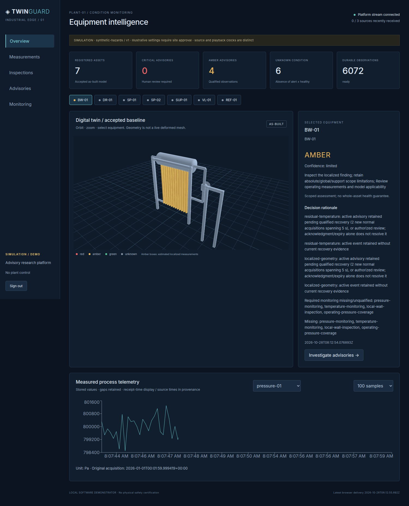
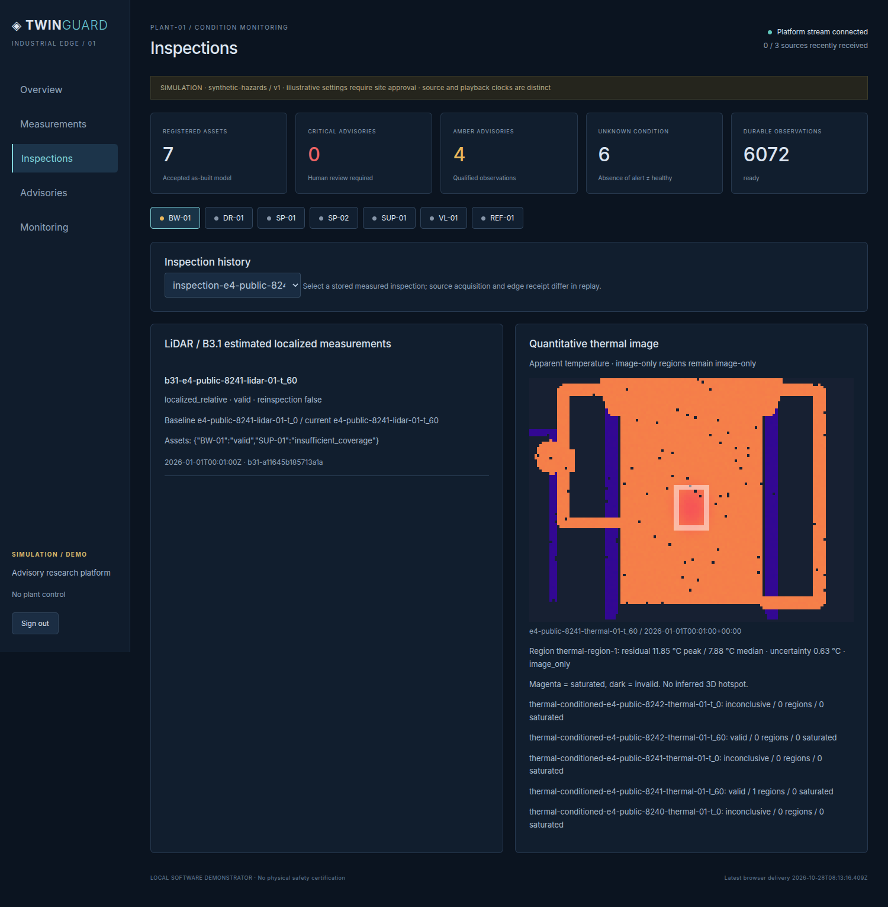
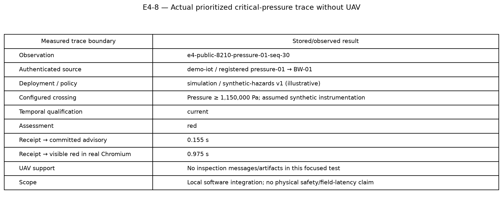

# Phase 5 validation — integrated edge research demonstrator

Completed 2026-10-28 (Asia/Calcutta). Version 0.6.0; schema 1.0.0. Branch phase-5-edge-platform. Starting Phase 4 commit a00bce3. Full E4 producer 32ac54d86216d0deef3d34676d4e018791fd7555; critical-path correction c62a159b72d70cd147078fd4826f064eff702119. Exact source/model/image/lock provenance is in phase5/results.json and phase5/final_revision.json. No Phase 6 work or physical plant control is implemented.

## A–B. Architecture and capabilities

The actual chain is public measured acquisition → authenticated Mosquitto QoS1 or read-only numeric OPC UA → registry/time/artifact validation → PostgreSQL inbox/observations/jobs → original operating/B3.1/thermal analytics → original F1 → atomic checkpoint/assessment/advisory/outbox → authenticated FastAPI/SSE → React/TypeScript/Three.js dashboard. Separate lightweight API/fast-worker and Open3D images run locally under Compose. Accepted baseline geometry remains static; displayed conditions, plots, regions and thermal values come from backend records.

Implemented modules and contracts are described in PHASE5_ARCHITECTURE.md, EDGE_INGESTION.md, MQTT_PROTOCOL.md, OPCUA_INTEGRATION.md, PERSISTENCE_AND_RECOVERY.md and PLATFORM_SECURITY.md. Source acquisition/claims, authenticated identity, actual receipt, calibration, clock trust and policy approval are separate. The browser cannot grant verified instrumentation or engineering authority.

## C. Phase 4 issues

| Issue | Correction and executed evidence |
|---|---|
| P4-1 identity/time | Broker credentials/ACLs and independent registry; actual receipt; unknown physical clocks remain unknown; six actual invalid MQTT cases quarantined; per-capture replay chronology tested |
| P4-2 durability | PostgreSQL constraints/leased jobs/atomic F1 state/outbox; all committed events preserved in controlled worker/API/database outages; bounded retry/retention tests |
| P4-3 illustrative limits | Distinct server-side simulation/site-review profiles; site template has no approved critical limits; unknown-calibration/clock tests cannot obtain authoritative critical decisions |
| P4-4 coverage | Per-channel monitoring, source staleness, missing requirements, calibration/clock status and actual L2 insufficient-coverage results; no alert-free healthy inference |
| P4-5 latency | Actual local publisher/receipt/commit/job/fusion/API/browser timestamps; full workload and priority correction measured, not simulated field latency |

## D. Start and demonstrate

See DEMO_WALKTHROUGH.md for complete executable commands and tokens/roles, and DASHBOARD_GUIDE.md for operator use. From a prepared repository:

```bash
./scripts/edge_build.sh
docker compose --env-file .edge/runtime.env -f deployment/compose.yaml up -d --no-build
```

Open http://localhost:18780 and enter the locally generated token from .edge/secrets.json. Host publishers require the explicit loopback validation overlay. Do not run two projects on the same ports. Scenario commands generate/stream actual healthy, geometric, thermal, critical-without-UAV and L2 data. Replay supports rates, pause/resume control and step mode, while original scientific times and actual processing remain distinct. No cloud service is required after installation/build.

## E. E4 numerical results

Full benchmark duration: **1011.61 seconds**. Distinct durable observations: **6,072**; completed jobs: **6,075**, including three actual inspection jobs. No failed/pending jobs at the sealed endpoint. The three normal datasets persisted **429/429, 426/426 and 431/431** distinct published readings. The sustained first publisher operated for **65.91 seconds** with ingestion, storage, analytics, F1, API and browser active. This is not a 24-hour endurance claim.

Completeness is measured from distinct publisher-side observation IDs, not ideal pre-dropout sensing schedules. At-least-once copies do not inflate completeness. Zero duplicate durable observations and zero repeated advisory-open effects were observed. Two leased jobs retried. Source sequence epochs, physical observation lineage and actual reordered acquisition are separately audited.

| Full benchmark stage | n | p50 s | p95 s | p99 s |
|---|---:|---:|---:|---:|
| Publisher to application receipt | 6072 | 0.0425 | 5.0513 | 7.5589 |
| Receipt to observed ingest commit | 6072 | 0.0106 | 0.0138 | 0.0171 |
| Fast IoT receipt to committed advisory | 6072 | 21.6156 | 46.4186 | 51.7347 |
| Inspection receipt to committed advisory | 3 | 1.2138 | 2.8702 | 3.0175 |

The full FIFO workload exposed a real limitation: **6/186** configured critical crossings were current at assessment and **180/186** had aged beyond the unchanged 10-second rule. Durable completeness and a latched red event do not prove timely interpretation of every reading. This was not hidden or addressed by increasing TTLs.

The final scheduler uses the existing engineering-limit adapter for a server-side urgency hint; the worker independently requalifies F1 evidence. Validated policy parsing is cached by file revision. In a fresh focused run with **302 older ordinary pending jobs**, the identical three public critical datasets yielded **186/186 current readings**, all producing red assessments. Receipt-to-committed-advisory latency was **0.5911 s p50 / 2.2495 s p95 / 4.5886 s p99**, max **4.6521 s**. The first red became visible in real Chromium after **0.975 seconds** from edge receipt, without UAV data.

This is a focused correction, not an independently repeated full fault/resource study. A separate combined transport-overload test still produced 62 already-aging/stale readings; priority cannot make data fresh before ingestion. All those runs are preserved. Source quality and temporal gates were not relaxed.

| Interrupted service | Stop request → readiness s | Committed event history retained |
|---|---:|---|
| fast-worker | 10.186 | True |
| broker | 7.206 | True |
| api | 8.470 | True |
| database | 8.324 | True |

Numeric OPC UA: nine channel/status records and 45 distinct observations in the short polled snapshot interval; interruption/reconnection was observed. This is not completeness against every simulator write. The read-only client rejects unsupported units/types and preserves original source/server status/times.

Actual inspection results: L1 geometric case **one qualified region**; thermal case **one valid apparent-temperature residual region**; L2 case **insufficient_coverage with no qualified region**. All three registered measured NPZ objects were retrieved through authenticated API calls and their SHA256 verified.

Hardware: 12th Gen Intel(R) Core(TM) i7-12700; 20 logical CPUs; 15.51 GiB reported host memory. Linux-6.18.54.1-microsoft-standard-WSL2-x86_64-with-glibc2.39. No industrial-edge hardware/GPU performance is inferred. Sampled peak summed container CPU **475.3%** (100% is one logical core); peak pending jobs **349**; peak database **179.84 MiB**. Per-service memory, response quantiles, raw samples and container limits are in the machine-readable artifacts. Browser heap/DOM/render smoke was observed; continuous FPS is not claimed.

The nominal source rate derived from actual source timestamps is **3.572 observations/s**. Raw observation JSON projects to **16.61 GiB/90 days**. A naive extrapolation of full measured database growth, including per-assessment traces/jobs/audits, is **768.90 GiB/90 days**. This is a capacity diagnostic, not a tested retention or linear-growth guarantee. Aggregation/backups/WAL and unresolved history need deployment planning; scientific/advisory history is conservatively preserved.

## F. Real browser demonstration

All final Chromium checks passed: model rendering, actual assets, selection, stored charts, inspection selection, thermal image, geometric interpretation, monitoring, evidence, red advisory history, authorized acknowledgment and reconnect. No page errors or external resource requests were observed. The independent final browser run records its actual timing and screenshots; the original full benchmark browser result remains preserved. These are screenshots of the running application, not UI mockups.





## G–H. Security and scientific integrity

Authenticated ingestion, topic ACLs, token roles, bounded upload/message sizes, safe content-addressed public artifacts, hash verification, and audited idempotent operator review are implemented. Actual unauthorized MQTT connection/topic attempts were rejected; API anonymous/viewer misuse returned 401/403; private artifacts returned 404; path traversal/private bundle attempts returned 422. Calibration/clock approval remains independent of transport authentication.

Runtime images exclude plant/evaluation/sensing generation code, private datasets/scenarios and private core configuration/registry modules. Only public measured observations, accepted as-built references and frozen healthy models enter inference. E1/E2/E3 outputs and all original numerical algorithms are unchanged. No hidden fault labels, true poses or true deformed surfaces feed analytics/F1/UI. Controller generation and optional evaluation remain outside deployed workers.

Default HTTP/MQTT/OPC UA transport is explicitly local laboratory operation. Backend services run on an internal network; the browser uses local resources. LAN TLS/certificate templates are provided but not commissioned/certified. Optional OPC UA NoSecurity is never described as production secure. Local role tokens are not enterprise SSO/expiry/rotation. Exact-once MQTT delivery, hardware latency and physical safety certification are not claimed.

## I. Regression and build checks

**266 Pytest tests passed**, one existing Starlette/httpx warning. Starting baseline: 227. Ruff lint/format, Mypy (91 source files), dependency checks, schema export, frontend build and three frontend semantics tests pass. Actual containers start, migrations execute, Open3D imports inside the heavy image, API health responds, protocols communicate, browser checks execute and services survive controlled restart. Required native libraries and exact Python/npm versions are recorded.

## J. Files and artifacts

- `src/twinguard/edge/`: contracts, secure ingress, real protocols, durable queue/store, workers, admin recovery and API adapter.
- `src/twinguard/api/app.py`: existing FastAPI integration; `frontend/`: React/TypeScript/Three.js application and lock.
- `deployment/compose.yaml`, `deployment/edge/`: full stack, separate images, validation and reviewed LAN templates.
- `migrations/`, `alembic.ini`, `configs/edge/`, `schemas/EdgeEnvelope.schema.json`, `schemas/SourceRegistration.schema.json`.
- `scripts/run_e4.py`, `verify_priority.py`, `edge_demo.py`, `edge_browser.py`, `summarize_e4.py`, `verify_edge_security.py`.
- `experiments/outputs/phase5-E4-release`: immutable full run, raw timestamps, input manifests, jobs, observations, predictions and seal.
- `experiments/outputs/phase5-E4-priority-verified`: immutable corrective workload and real critical browser capture.
- `docs/phase5/results.json`, `priority_comparison.json`, `timeline.json`, `resource_samples.json`, `checks.json`, `security_checks_release.json`, `final_revision.json`.
- `docs/figures/phase5/`: eight required measured/architecture/browser figures plus numerical source data and selected inspection views.

## K. Limits and failure history

Earlier development outputs are retained, including the timestamp/provenance association issue, OPC UA immutable timestamp constructor error, missing Open3D native dependency and browser data-wait race. Final native dependencies, per-capture replay clocks, source-provenance binding, actual actor acknowledgment, safe derived artifacts and priority behavior were rerun, not asserted from documentation. No final metrics overwrite those failed observations.

Physical sensors/site-approved limits/calibration and verified synchronization are not commissioned. Standard arbitrary third-party OPC UA address spaces require a reviewed mapping/adapter; the demonstrated schema is explicit numeric nodes plus public lineage. No crash-safe publisher disk spool or HA cluster is claimed. Retention archives bounded raw inbox records and preserves all referenced scientific/decision history; complete automated long-horizon scientific deletion/aggregation is not enabled. L2 geometry remains limited; B3.1 is localized_relative, not certified absolute wall thickness. Thermal findings remain apparent-temperature/image-only when physical association is unsupported. Sampling, accelerated replay, queueing and finite fault tests do not establish industrial safety/reliability.

## L. Acceptance and Phase 6 readiness

| # | Criterion | Decision / evidence |
|---:|---|---|
| 1 | Prior Phase 0–4 behavior | PASS — Unchanged plant/sensing/analytics/fusion code; full prior regression retained |
| 2 | Real MQTT | PASS — Mosquitto QoS1 + paho; actual published IDs matched SQL |
| 3 | Real read-only OPC UA | PASS — Nine numeric channels/status records; reconnect; read-only denial test |
| 4 | Synthetic public streams | PASS — Original TwinGuard generation/sensing; opaque public dataset IDs |
| 5 | Authenticated sources | PASS — Non-default credentials, broker ACLs, registry identity, real rejection tests |
| 6 | Source/asset mapping | PASS — Registered sensor/asset/type/unit/configuration validation |
| 7 | Actual receipt | PASS — Independent edge UTC receipt alongside original source records |
| 8 | Clock trust | PASS — Server registry trust; per-capture source anchors/rates; payload claims do not grant synchronization |
| 9 | Invalid quarantine | PASS — Six actual invalid MQTT cases; bounded digest/reason audit |
| 10 | Durable deduplication | PASS — SQL keys; duplicate envelopes/representations; no repeated open effects |
| 11 | Artifact integrity/confinement | PASS — Bounded public bundles and verified immutable raw/registered NPZ downloads |
| 12 | Durable database | PASS — PostgreSQL named volume; non-superuser application role |
| 13 | Migrations | PASS — Alembic 0001_edge exercised on fresh deployments |
| 14 | Restart-safe jobs | PASS — Leases, owner checks, bounded retries and exhausted-lease quarantine |
| 15 | Durable checkpoints | PASS — Locked F1 JSON state in transaction |
| 16 | Durable advisory lifecycle | PASS — Committed events/notices/actions retained through outages |
| 17 | Idempotent effects | PASS — Zero duplicate observations/open effects; repeated acknowledgment stable |
| 18 | Retention/archival | PASS — Bounded raw archival tested; unresolved/scientific references conservatively preserved |
| 19 | Operating analytics | PASS — Original inference with provenance-bound ingested context |
| 20 | B3.1 integration | PASS — Actual public LiDAR pairs; qualified L1 region and L2 insufficient coverage |
| 21 | Thermal integration | PASS — Actual quantitative arrays/masks; valid apparent-temperature residual region |
| 22 | F1 integration | PASS — Unchanged Phase 4 engine and semantic gates |
| 23 | Independent critical path | PASS — Separate fast worker + server-derived priority; 186/186 current in focused correction |
| 24 | Version provenance | PASS — Policy, source/model/lock hashes and image identifiers retained |
| 25 | Missing/inconclusive explicit | PASS — No missing-input green; L2 inconclusiveness and source staleness displayed |
| 26 | Deployment profiles | PASS — Illustrative simulation versus unknown/unapproved site review |
| 27 | Functional API | PASS — Historical/current queries, pagination, filters, role-protected actions |
| 28 | Live browser | PASS — Actual SSE receipt, visible red, resumed cursor and backend snapshot |
| 29 | Accepted 3D baseline | PASS — Real GLB/WebGL screenshot; no simulated deformation animation |
| 30 | Asset interaction | PASS — Actual selection and condition detail browser checks |
| 31 | Measured geometric regions | PASS — Selected qualified inspection overlay with localized-relative limitations |
| 32 | Qualified thermal display | PASS — Actual quantitative image, masks, bounds/residuals; image-only remains image-only |
| 33 | Stored telemetry charts | PASS — Actual SQL values, units/source times, invalid gaps |
| 34 | Explainability | PASS — Evidence IDs, hazards, current/historical support, policy/profile and rationale |
| 35 | Monitoring health | PASS — Per-source/channel receipt, clock, calibration, freshness, coverage and backlog |
| 36 | Authorized acknowledgment | PASS — Real operator browser/API checks; viewer 403; acknowledgment does not resolve |
| 37 | No actuation | PASS — No control routes or OPC UA plant write client; laboratory read-only rejection checked |
| 38 | Full Compose stack | PASS — Broker/DB/ingestion/fast/heavy/API/frontend; persistent volumes and health checks |
| 39 | Local offline operation | PASS — Internal backend network; no external browser resources; installation/build needs separate dependencies |
| 40 | Controlled recovery | PASS — Worker, broker, API, database and OPC UA interruptions executed |
| 41 | Executed E4 | PASS — Sealed 16.86-minute full benchmark plus focused corrective workload |
| 42 | Measured metrics | PASS — Completeness, latency, resource, recovery and capacity with sample counts/caveats |
| 43 | Real browser evidence | PASS — All final browser checks true; genuine screenshots, no mock UI |
| 44 | Scientific isolation | PASS — Restricted code/data absent from runtime images; public contracts/arrays and frozen references |
| 45 | Regression/build checks | PASS — 266 tests; Ruff/Mypy; frontend build/3 tests; real protocols and image startup |
| 46 | Documentation/schema handoff | PASS — Required guides, additive schemas, CLI and measured evidence register |

Phase 5 local software demonstrator: **PASS**, with the measured FIFO/transport limits and focused corrective scope above. Physical/production deployment readiness: **PARTIAL**. Phase 6 software research handoff: **CONDITIONAL GO**. Asset conditions, scoped coverage, uncertainty/qualification, actual freshness, inspection history, accepted geometry and reported viewpoint poses are available through public records/APIs. Viewpoint feasibility, UAV dynamics/obstacles/flight safety, approved hardware/site policy and field validation are still required before physical risk-adaptive inspection. No Phase 6 optimization or actuation was started.
