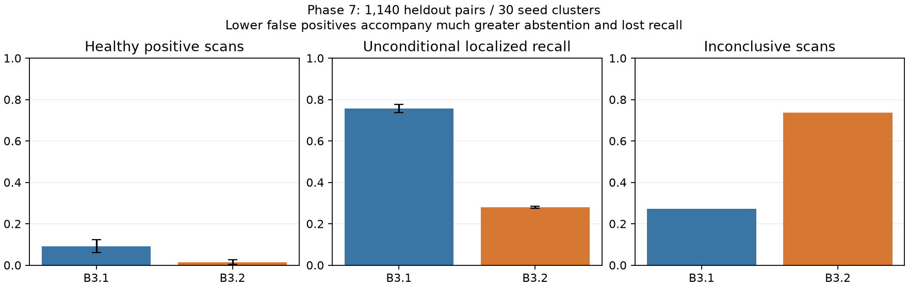

# Phase 7 independent validation

Frozen production candidates: `edae1e5`, software 0.8.0. No detector, registration, sensing, calibration or utility tuning followed final evaluation. Source/model hashes and disjoint seed ranges are in `phase7/CANDIDATE_FREEZE.json`. The later destination-aware resource guard is an infrastructure change with separately retained provenance, not scientific tuning.

## Detector heldout results

All **1,140 actual scan pairs** completed: 900 L1 pairs, plus 240 L0/L2 stress pairs. Thirty independent final seeds (15000–15029), six L1 views, healthy and 10/20/30/50 mm targets, steady and load-transition cases. Same measured pair, same registration and original quality gates feed both detectors. Public predictions are sealed before footprint evaluation. Confidence intervals resample whole seeds, 2,000 replicates, fixed RNG; they describe this synthetic distribution, not physical generalization.

| Detector | Localized faults | Recall (95% seed-cluster CI) | Healthy positive scans | FPR (95% CI) | Inconclusive | Region precision |
|---|---:|---|---:|---|---:|---|
| B3.1 | 635/840 | 0.756 (0.736–0.776) | 27/300 | 0.090 (0.060–0.123) | 309/1140 | 0.857 |
| B3.2 | 235/840 | 0.280 (0.274–0.285) | 4/300 | 0.013 (0.003–0.027) | 840/1140 | 0.912 |

B3.2 is **not promoted**: its false-positive reduction is accompanied by much more abstention and substantially lower unconditional recall. Qualified-only comparisons select different subsets. Both have 189 registration failures; B3.2 calibration applies to only 300 scans. L2 remains unsupported. Per-fidelity, view, qualification and timing rows remain in the case journals; aggregate per-fidelity uncertainty is in `phase7/heldout_detector_summary.json`.

## Paired planners and real acquisition ablations

The predeclared main campaign contains 240 cases × five planners × two common detectors. Initial/new/cumulative/additional/confirmation recall are separate, localization requires qualified significant patch-center overlap, and healthy positives/inconclusive/area/yield/actual CPU/RSS are retained. The source initial partial-view family unexpectedly detects all B3.1 targets; its label is not accepted as proof of a previously missed defect. A separately frozen supplemental protocol uses a fixed accepted-map left view, an independent static occluder shared with the accepted map, and an explicitly tiny measured sufficient-coverage scope. Development seeds 17100/17101 are separate from final controls 17000–17029.

All six acquisition ablations completed 180 fresh trials. Some variants select zero further views; those are **uninformative about reinspection benefit**, despite actually reacquiring their initial scan pairs. B3.2 selected-view totals across the six removals are 30 (adaptive replanning), 49 (calibration applicability), 58 (coverage history), 50 (redundancy penalty), 43 (registration suitability), and 26 (risk priority). Do not compare an incomplete main campaign subset against all 30 ablation seeds. Final main/supplemental results require completed journals; current status is recorded in the linked summaries, not inferred from software tests.

Artifacts: `phase7/heldout_planner_summary.json`, `phase7/acquisition_ablation_summary.json`, main case journal at `experiments/outputs/phase7-V3-heldout-planners`, and external controls at `/mnt/d/TwinGuard/phase7-V3-supplemental-heldout-controls`. Commands: `scripts/phase7_detector_study.py`, `scripts/phase7_planner_study.py`, `scripts/phase7_supplemental_controls.py`, and `scripts/phase7_summarize.py`. Use a new output directory; explicit resume verifies checkpoint hashes. External-drive migration retains the original evidence and records its allowed infrastructure-only source changes.

## Identical supported-domain comparison

Restricting both detectors to the same 300 public applicability-domain cases isolates calibration from abstention: B3.1 localized 237/240 faults and produced 18/60 healthy positive scans; B3.2 localized 235/240 and produced 4/60. Neither was inconclusive in that subset. This demonstrates a conditional false-positive reduction with a small sensitivity tradeoff. It does not establish overall superiority or support outside these domains.

## Complete paired planner outcomes

240 paired cases, five methods under each common detector. Each detector has 120 fault cases and 120 healthy/control cases. Main amplitudes are10/20/30mm;50mm is included in the separate detector study. The comparison is LiDAR-only; equivalent thermal/multi-asset geometric calibration is not claimed.

| Detector / planner | Views | Initial / new / cumulative recall | Additional recall among initial misses | Healthy positive trials (rate) | Inconclusive scans | New qualified area total m² |
|---|---:|---|---|---|---:|---:|
| B3.1 / P0 | 360 | 0.750 / 0.742 / 0.750 | 0.000 | 0.192 | 73 | 153.361 |
| B3.1 / P1 | 360 | 0.750 / 0.725 / 0.750 | 0.000 | 0.092 | 12 | 209.678 |
| B3.1 / P2 | 360 | 0.750 / 0.742 / 0.750 | 0.000 | 0.192 | 73 | 153.361 |
| B3.1 / P3 | 360 | 0.750 / 0.742 / 0.750 | 0.000 | 0.233 | 5 | 177.319 |
| B3.1 / P3v2 | 57 | 0.750 / 0.000 / 0.750 | 0.000 | 0.008 | 3 | 25.067 |
| B3.2 / P0 | 360 | 0.250 / 0.708 / 0.725 | 0.633 | 0.100 | 180 | 141.119 |
| B3.2 / P1 | 360 | 0.250 / 0.200 / 0.367 | 0.156 | 0.042 | 150 | 72.647 |
| B3.2 / P2 | 360 | 0.250 / 0.708 / 0.725 | 0.633 | 0.100 | 180 | 141.119 |
| B3.2 / P3 | 360 | 0.250 / 0.258 / 0.317 | 0.089 | 0.133 | 130 | 71.535 |
| B3.2 / P3v2 | 148 | 0.250 / 0.192 / 0.442 | 0.256 | 0.000 | 66 | 35.014 |

All seed-cluster intervals and confirmation/precision/resource statistics are in `heldout_planner_summary.json`. Lower false-positive or inconclusive totals with fewer acquired views are not evidence of superiority. Initial screening, new-scan localization, additional discovery and confirmation remain distinct. The original `previously_unconfirmed` family is initially positive under B3.1; genuinely unconfirmed fixed-left controls are reported separately. The main stale_initial case delivers old-timestamp data after a later decision; it must not be interpreted as fresh reacquisition. A separate 30-seed chronology campaign acquires at7272/7280 after the aged decision without rewriting source timestamps.

## Actual per-view yield and resources

Sealed result hashes and every referred raw/registered point-cloud hash were checked before per-view evaluation. Qualified area was recomputed from estimated registered public points and unchanged valid patch bounds, agreeing with every frozen case. These are accepted-map association/area estimates, not surveyed physical coverage. Visibility errors compare the union of executed nominal predicted-visible cells with measured registered-point association.

| Detector / planner | Useful localized views / all views | Useful views / mission-proxy minute | New scan payload MiB | Analysis wall s | Visibility-error MAE m² |
|---|---|---:|---:|---:|---:|
| B3.1 / P0 | 133/360 | 1.9869844707665634 | 48.51 | 307.68 | 0.582 |
| B3.1 / P1 | 155/360 | 2.371210505456151 | 54.74 | 348.34 | 0.421 |
| B3.1 / P2 | 133/360 | 1.9869844707665634 | 48.51 | 301.28 | 0.582 |
| B3.1 / P3 | 165/360 | 2.825549481591129 | 51.24 | 349.30 | 0.713 |
| B3.1 / P3v2 | 0/57 | 0.0 | 9.02 | 53.36 | 0.022 |
| B3.2 / P0 | 85/360 | 1.269877293347052 | 48.51 | 236.40 | 0.582 |
| B3.2 / P1 | 27/360 | 0.4220860632388973 | 55.40 | 333.11 | 0.415 |
| B3.2 / P2 | 85/360 | 1.269877293347052 | 48.51 | 235.78 | 0.582 |
| B3.2 / P3 | 36/360 | 0.6166962659642394 | 51.41 | 311.34 | 0.704 |
| B3.2 / P3v2 | 23/148 | 0.8168904991341344 | 23.48 | 146.29 | 0.141 |

Mission time is a static route/acquisition proxy, not measured flight time. Controller CPU/wall totals include unequal shared-acquisition-cache and generation overhead, so they cannot establish planner-runtime superiority. Inner optimizer timing excludes P3v2 suitability preprocessing. Actual per-view inference and payload accounting is separately reported. Absolute CPU/RSS values and environment changes are retained, without extrapolation to industrial edge hardware.

## Supplemental heldout controls

90/90 cases completed.

| Control / detector / method | Trials | Initial public unconfirmed | Views | Newly localized | Healthy positive | Inconclusive | Actually scoped-qualified | Continue monitoring |
|---|---:|---:|---:|---:|---:|---:|---:|---:|
| independent_occluder / B3.1 / P0 | 30 | 0 | 60 | 15 | 0 | 42 | 0 | 0 |
| independent_occluder / B3.1 / P1 | 30 | 0 | 60 | 28 | 0 | 8 | 0 | 0 |
| independent_occluder / B3.1 / P2 | 30 | 0 | 60 | 15 | 0 | 42 | 0 | 0 |
| independent_occluder / B3.1 / P3 | 30 | 0 | 60 | 27 | 0 | 8 | 0 | 0 |
| independent_occluder / B3.1 / P3v2 | 30 | 0 | 0 | 0 | 0 | 0 | 0 | 0 |
| independent_occluder / B3.2 / P0 | 30 | 30 | 60 | 13 | 0 | 45 | 0 | 0 |
| independent_occluder / B3.2 / P1 | 30 | 30 | 60 | 0 | 0 | 60 | 0 | 0 |
| independent_occluder / B3.2 / P2 | 30 | 30 | 60 | 13 | 0 | 45 | 0 | 0 |
| independent_occluder / B3.2 / P3 | 30 | 30 | 60 | 16 | 0 | 40 | 0 | 0 |
| independent_occluder / B3.2 / P3v2 | 30 | 30 | 7 | 2 | 0 | 5 | 0 | 0 |
| missed_left / B3.1 / P0 | 30 | 30 | 60 | 30 | 0 | 11 | 0 | 0 |
| missed_left / B3.1 / P1 | 30 | 30 | 60 | 28 | 0 | 1 | 0 | 0 |
| missed_left / B3.1 / P2 | 30 | 30 | 60 | 30 | 0 | 11 | 0 | 0 |
| missed_left / B3.1 / P3 | 30 | 30 | 60 | 28 | 0 | 1 | 0 | 0 |
| missed_left / B3.1 / P3v2 | 30 | 30 | 30 | 28 | 0 | 0 | 0 | 0 |
| missed_left / B3.2 / P0 | 30 | 30 | 60 | 25 | 0 | 30 | 0 | 0 |
| missed_left / B3.2 / P1 | 30 | 30 | 60 | 7 | 0 | 23 | 0 | 0 |
| missed_left / B3.2 / P2 | 30 | 30 | 60 | 25 | 0 | 30 | 0 | 0 |
| missed_left / B3.2 / P3 | 30 | 30 | 60 | 3 | 0 | 31 | 0 | 0 |
| missed_left / B3.2 / P3v2 | 30 | 30 | 40 | 10 | 0 | 9 | 0 | 0 |
| sufficient_scope / B3.1 / P0 | 30 | 30 | 60 | 0 | 12 | 17 | 21 | 0 |
| sufficient_scope / B3.1 / P1 | 30 | 30 | 60 | 0 | 7 | 3 | 21 | 0 |
| sufficient_scope / B3.1 / P2 | 30 | 30 | 60 | 0 | 12 | 17 | 21 | 0 |
| sufficient_scope / B3.1 / P3 | 30 | 30 | 60 | 0 | 15 | 0 | 21 | 0 |
| sufficient_scope / B3.1 / P3v2 | 30 | 30 | 0 | 0 | 0 | 0 | 21 | 23 |
| sufficient_scope / B3.2 / P0 | 30 | 30 | 60 | 0 | 5 | 30 | 26 | 0 |
| sufficient_scope / B3.2 / P1 | 30 | 30 | 60 | 0 | 4 | 24 | 26 | 0 |
| sufficient_scope / B3.2 / P2 | 30 | 30 | 60 | 0 | 5 | 30 | 26 | 0 |
| sufficient_scope / B3.2 / P3 | 30 | 30 | 60 | 0 | 7 | 7 | 26 | 0 |
| sufficient_scope / B3.2 / P3v2 | 30 | 30 | 0 | 0 | 0 | 0 | 26 | 29 |

## Fresh-after-aged chronology controls

23/30 cases completed.

| Control / detector / method | Trials | Initial public unconfirmed | Views | Newly localized | Healthy positive | Inconclusive | Actually scoped-qualified | Continue monitoring |
|---|---:|---:|---:|---:|---:|---:|---:|---:|

Supplemental controls use fresh17000–17029 seeds, separate17100/17101 development; chronology uses17200–17229 after17300/17301 development. The first sufficient-scope pilot chose a non-visible face cell and failed qualification; the corrected protocol fixes the nominal front-face cell before final evaluation. An OOM and a recycled-executor stall were preserved and recovered with explicit one-case process shards; only execution/metadata lookup changed. No calibration, sensing noise, production planner, registration or filtering rule was retuned from heldout outcomes. All prior and interrupted evidence remains.

## Explicit incomplete extra chronology study

Only 23/30 cases are journal-committed. Source-host C: fell below the retained1GiB operating floor although output is on D:. Unused build-cache cleanup reclaimed2.898GB inside Linux but did not restore Windows backing-drive headroom. No resource guard was lowered, no missing result was synthesized, and no aggregate benefit is claimed from this partial subset. All240main cases and90supplemental controls are complete; the remaining extra chronology cases and their fragments remain pending.
