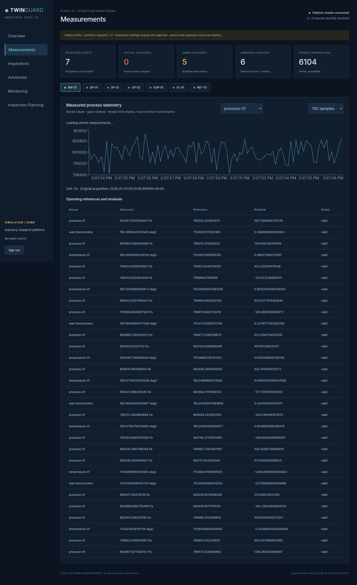
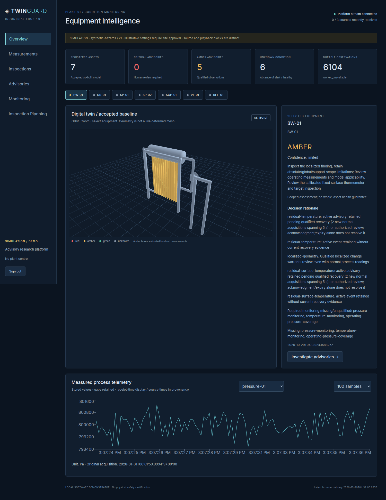

# Phase 7 integrated demonstration

Actual local browser and backend demonstrations; no physical flight, plant actuation or site-operator acceptance. Original analytics and F1 were used. Full E4 retest finished 6204 jobs; fresh reviewed reinspection and duplicate/restart checks followed on the isolated corrected stack.

| Case | Executed evidence | Result and boundary |
|---|---|---|
| D1 Normal monitoring | Three full E4 B1 normal streams, actual persisted trends | Normal input processed; scoped/unknown hazards are not blanket green |
| D2 Local deformation | Full B8 geometry plus fresh reviewed 20 mm software target | Reviewed result valid with **2 regions**; F1 **amber** |
| D3 Thermal | Actual B8 thermal acquisition, worker and browser image | Numeric residual/image displayed; image-only association does not prove a 3D hotspot |
| D4 Critical without UAV | B7 pressure streams occur before first inspection job | Independent raw pressure can escalate; 18/186 stale in full run remains a timeliness failure |
| D5 Missing data | Protocol stop, 16 s wait, monitoring endpoint | Stale channels / no_recent_data / unknown_or_unavailable stored in B6 profile |
| D6 Plan → imperfect acquisition → F1 → replan | Fresh backend P0 recommendation, explicit simulation review, sealed requested pose, original sensing, import, job and P3v2 replan | Plan `plan-f4298fe636b0c97a49c7ca79`; inspection `simulation-73c3f1785966435187d2ea290b7bb956`; replan `plan-93cb5852814e72f580a6cbf0`. No direct-control endpoint |
| D7 Inconclusive | Actual L2 inspection and heldout L2 failures | Inconclusive remains distinct from healthy; no forced detection |
| D8 Recovery without duplicate opens | Full service restarts preserve IDs; exact inspection envelope replayed twice around worker restart | **True** no new event IDs, one inspection job row, 2 duplicate audit entries |
| D9 Unauthorized rejection | Live API/MQTT and malformed artifact tests | 401/403/422 and quarantines retained |
| D10 Displayed evidence audit chain | Actual Chromium model/assets/trends/inspection/thermal/geometric/monitoring/evidence/ack/reconnect checks | All twelve browser checks passed; screenshots/logs retained |

Fresh reviewed reinspection: `/mnt/d/TwinGuard/phase7-V7-reviewed-reinspection` contains frozen plan, plan-ready hash, actual public measurement bundle, linked result, F1 condition and replan. Browser/recovery: `/mnt/d/TwinGuard/phase7-V7-browser-and-recovery`. Full workload screenshots: `experiments/outputs/phase7-V4-full-E4-recovery-retest/browser`. Tracked compact records: `phase7/integrated_reinspection.json`, `phase7/integrated_browser_recovery.json`. The local test principal records software review only; no human/site approval is fabricated.

Reproduce with new output locations using `scripts/phase7_integrated_reinspection.py` and `scripts/phase7_integrated_capture.py`, against the explicit corrected loopback stack. The latter stops the completed test fast worker after capture to avoid unlimited idle-history growth.

## Strengthened actual-value browser verification

The inherited chart check only established a chart container. The strict follow-up exposed an obsolete asset-response race and a stream-refresh clearing issue; both were corrected. A deliberately delayed DR-01 response cannot replace BW-01 values. The final browser renders100 actual stored pressure samples with Pa units and nonempty SVG line geometry, with no JavaScript errors. Failed and passing strict runs remain on the external drive.

